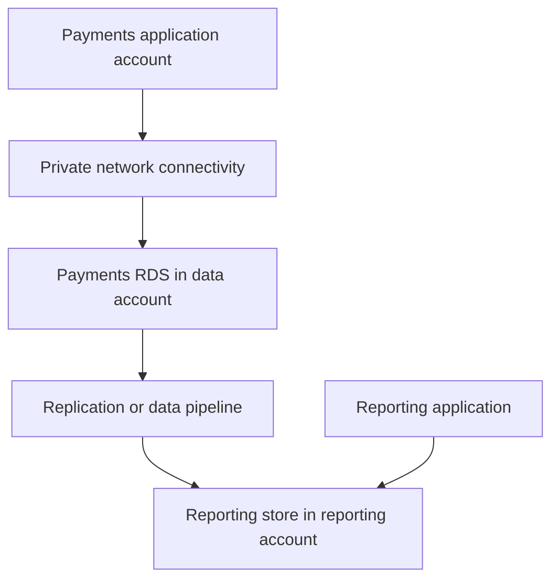

# Amazon RDS Explained: Availability, Upgrades, and Cross-Account Access

Running a database involves more than starting a server. Someone has to maintain the underlying infrastructure, manage backups, prepare for failures, and plan upgrades without breaking the application.

Amazon Relational Database Service, or RDS, takes care of much of that infrastructure work. But using a managed database still leaves you with important decisions: how applications connect, how much downtime you can tolerate, how you recover lost data, and who should have access.

This guide walks through those decisions, from the basic RDS components to a practical design for applications running across multiple AWS accounts.

## What RDS manages, and what you still own

Imagine an application that stores customer accounts, orders, and payments in PostgreSQL. On a self-managed server, your team looks after both the database and the machine running it. With RDS, AWS handles provisioning, underlying hardware, and supported maintenance and backup operations according to your configuration.

Your team still owns the data model, indexes, queries, database permissions, capacity choices, and application behavior. You also need to configure backup retention, test recovery, and plan engine upgrades.

A slow query still needs investigation. An overly permissive database user still creates risk. RDS reduces the infrastructure work, but the database remains part of your system to operate.

These are the components you will encounter most often:

| Component | What it controls |
| --- | --- |
| Database engine | The database software, such as PostgreSQL, MySQL, MariaDB, Oracle, SQL Server, or Db2 |
| DB instance | The compute and memory available to the database |
| Storage | Capacity and storage performance, including IOPS and latency |
| Endpoint | The DNS name applications use to connect |
| Security group | Which sources can reach the database port |
| DB subnet group | The subnets RDS can use for database placement |
| Parameter group | Engine settings, some of which require a restart to change |
| Option group | Additional features for engines that use option groups |
| KMS key | Encryption-key access for encrypted database resources and backups |

Applications should connect through the database endpoint rather than a hard-coded IP address. The underlying address can change during operations such as failover, so connection handling and DNS behavior matter too.

### Where Aurora fits

RDS for PostgreSQL and RDS for MySQL run managed versions of those database engines. Amazon Aurora is also part of the RDS service family, but uses a different storage architecture and offers PostgreSQL-compatible and MySQL-compatible editions.

Compatibility does not make every operational detail identical. Check the engine and deployment type when planning replication, failover, or upgrades. Running a database on EC2 is another option when you need control or capabilities that a managed offering cannot provide, with the additional operational work that comes with it.

## Start with the failure you need to handle

“We need another database copy” sounds straightforward, but it can describe several different requirements.

You might need the application to survive an Availability Zone failure. You might need to move reporting queries away from the writer. Or you might need to recover data after an accidental deletion. Those needs lead to different designs.

### Multi-AZ and read replicas solve different problems

In a **Multi-AZ DB instance deployment**, RDS maintains a synchronous standby in another Availability Zone. That standby provides failover support and does not accept application read traffic.

A **read replica** gives applications another database to query. Replication is generally asynchronous, so the replica can fall behind the source. That delay matters when an application expects to read a change immediately after writing it.

There is also an **RDS Multi-AZ DB cluster** deployment. It has one writer and two readable instances across three Availability Zones and uses semisynchronous replication. It is a separate deployment model from both a Multi-AZ DB instance and an Aurora cluster.

| Deployment | Main purpose | Additional readable instances | Replication model |
| --- | --- | --- | --- |
| Single-AZ DB instance | Run a database in one AZ | None by default | No standby by default |
| Multi-AZ DB instance | Availability and failover | Standby is not readable | Synchronous |
| Read replica | Read scaling or a supported migration/DR workflow | Yes | Generally asynchronous |
| Multi-AZ DB cluster | Availability with read capacity | Two readable instances | Semisynchronous |

Choose availability features around your downtime requirements, then choose read capacity around the workload. If stale reads would break a workflow, decide which queries must stay on the writer.

See the AWS guides for [Multi-AZ deployments](https://docs.aws.amazon.com/AmazonRDS/latest/UserGuide/Concepts.MultiAZ.html) and [Multi-AZ DB clusters](https://docs.aws.amazon.com/AmazonRDS/latest/UserGuide/multi-az-db-clusters-concepts.html).

## How an application reaches a private database

A common production setup places RDS in private database subnets and disables public accessibility. The application reaches it over private networking, with the database security group allowing only the required sources and port.

For example, an application using PostgreSQL might connect on TCP port `5432`. Where security-group referencing is supported, the database rule can allow the application's security group instead of a broad IP range. MySQL commonly uses port `3306`; always check the configured port.

The DB subnet group must cover the Availability Zones required by the deployment. For a typical regional DB instance, that means subnets in at least two AZs. A Multi-AZ DB cluster uses three. A subnet group covering multiple AZs does not, by itself, make a Single-AZ database highly available.

Use TLS with certificate verification for client connections. Keep credentials in a secret-management system, such as AWS Secrets Manager, or use IAM database authentication where the engine and configuration support it. Neither choice replaces database authorization.

### When a connection fails, follow the path

“The application server has internet access” tells you very little about its ability to reach a private database.

Start with the endpoint and work through the connection:

1. **DNS:** Does the endpoint resolve from the application environment?
2. **Routing:** Is there a network path to the database and a return path?
3. **Traffic rules:** Do security groups and network ACLs permit the connection?
4. **Endpoint and port:** Is the application targeting the correct database and port?
5. **TLS and authentication:** Does the client trust the certificate, and are the credentials valid?
6. **Database access:** Can that user connect to the requested database and perform the required operations?

Security groups are stateful, so response traffic for an allowed connection is permitted automatically. Network ACLs are stateless and need rules for both directions, including the relevant ephemeral ports.

The error usually helps narrow the search. A timeout points toward reachability or an unresponsive service. An authentication error shows that the connection got far enough to attempt a login. Neither diagnosis should rely on the error message alone, but it gives you a useful starting point.

AWS documents common layouts in [Scenarios for accessing a DB instance in a VPC](https://docs.aws.amazon.com/AmazonRDS/latest/UserGuide/USER_VPC.Scenarios.html).

## Treat engine upgrades as application changes

An engine upgrade can affect SQL behavior, extensions, drivers, authentication, and query performance. Even when RDS performs the upgrade, your team needs to confirm that the application works afterward.

For PostgreSQL, moving from `15.x` to `16.x` is a major upgrade. Moving between releases within version `16` is a minor upgrade. These illustrate version numbering, not recommended upgrade targets.

Minor upgrades generally contain compatible fixes, but still need testing and downtime planning. Major upgrades require a closer review of compatibility and the supported upgrade path for the exact engine and deployment.

Automatic minor version upgrades do not necessarily select the newest available release. AWS can also apply required minor upgrades for critical security issues or end-of-support situations even when automatic minor upgrades are disabled. Check the engine-specific policy before making maintenance commitments.

### Rehearse before changing production

A useful rehearsal starts with production-like data in an isolated environment. Upgrade that environment, run the application, and compare important queries and business operations with the existing version.

Check extensions, parameter-group families, client drivers, deprecated features, and replication requirements. A technically successful upgrade can still leave an application with slower queries or broken assumptions.

Before the production change, take a manual snapshot and confirm the recovery procedure. Agree on a maintenance window, pause work that could interfere, and define what would make you stop or recover. Afterward, validate connections, application errors, latency, replication health, and actual business transactions.

Choosing **Apply immediately** can trigger a disruptive change soon after submission. Scheduling a change for a maintenance window controls its timing; it does not remove the need to prepare for interruption.

### Where blue/green deployments help

For supported configurations, RDS Blue/Green Deployments maintain a separate environment that you can prepare and test before switching production over. This can reduce upgrade downtime and give you more room to validate the target environment.

You still need to check feature restrictions, replication health, application compatibility, and connection recovery during switchover.

Be especially careful with the word **rollback**. An engine downgrade is generally not an in-place recovery option. Restoring a pre-upgrade snapshot creates a separate database and does not contain writes made after that snapshot. Similarly, retaining the old blue environment does not automatically keep it current with writes made after switchover. Your recovery plan must account for those writes.

Use the [RDS engine upgrade guide](https://docs.aws.amazon.com/AmazonRDS/latest/UserGuide/USER_UpgradeDBInstance.Upgrading.html) and the documentation for your engine before choosing an upgrade method.

## Backups protect you from a different kind of failure

Suppose a deployment accidentally deletes customer records. A standby or replica can receive that deletion too. Having another running copy does not give you the earlier data back.

Automated backups and point-in-time recovery help recover an earlier database state within the configured retention period. Manual snapshots provide a recovery point before a planned change. Cross-Region and cross-account copies can support disaster recovery and isolation, depending on how you configure them.

| Requirement | Relevant mechanism |
| --- | --- |
| Recover from an instance or AZ failure | Multi-AZ deployment |
| Recover data from before a bad change | Backups and point-in-time recovery |
| Preserve a pre-change recovery point | Manual snapshot |
| Recover after a regional disruption | A tested cross-Region recovery design |
| Keep a copy under separate account ownership | Cross-account backup or snapshot-copy workflow |

A successful backup is only part of the evidence. Restore it, measure how long recovery takes, and verify that the application can use the restored database. That is how you learn whether the design meets your recovery time and acceptable data-loss targets.

## Cross-account access starts with a question

When someone asks for “cross-account RDS access,” first establish what they actually need.

Does an application need to query a live database in another account? Does an analytics team need a reporting dataset? Or does a recovery account need an independently owned backup?

Those are different requirements. Network connectivity answers only the first part of the problem; database permissions, data ownership, and workload isolation still need decisions.

### Connecting separate VPCs

VPC peering can work well for a small number of direct connections. The VPC CIDR ranges must not overlap, both sides need appropriate routes, and traffic rules must allow the database connection. Peering is not transitive: connecting A to B and B to C does not connect A to C.

For a larger network, Transit Gateway provides a hub for connecting VPCs. It can simplify connectivity management, but route tables and segmentation still determine which applications can reach which databases. Consider cost and operating complexity alongside the number of connections.

Across accounts or Regions, check the restrictions on security-group references rather than assuming a rule from a same-VPC deployment will work unchanged.

### Sharing a VPC

VPC sharing is a different arrangement. A network account owns the VPC and shares subnets with eligible participant accounts through AWS Resource Access Manager. Supported resources from those accounts can then use the shared network.

This can separate network ownership from application and database ownership without creating a separate VPC for every account. It still requires clear rules for resource support, security groups, permissions, and who operates each part of the system.

See [VPC subnet sharing](https://docs.aws.amazon.com/vpc/latest/userguide/vpc-sharing.html) for the ownership model and requirements.

### Be precise about PrivateLink

An interface endpoint for the **RDS API** provides private access to management operations. It does not make a PostgreSQL or MySQL database connection available through that endpoint.

PrivateLink can be useful when another account should call a service API that your team owns, with that service accessing RDS internally. Publishing raw database access is a separate design problem. Avoid relying on manually tracked RDS IP addresses, which can change during failover.

AWS explains the management endpoint in [Amazon RDS API and interface VPC endpoints](https://docs.aws.amazon.com/AmazonRDS/latest/UserGuide/vpc-interface-endpoints.html).

### Sometimes the right solution is a data copy

A reporting team may need fresh data without needing direct access to the production writer. Depending on freshness and workload requirements, a reporting database, warehouse, ETL pipeline, AWS DMS task, or supported replication method may fit better.

For a one-time transfer or recovery workflow, a shared snapshot may be enough. Check the restrictions for the deployment type: snapshot sharing is not supported uniformly across all RDS configurations.

Encryption adds another permission boundary. A snapshot encrypted with the default AWS-managed RDS KMS key cannot be shared directly. A supported workflow uses a customer-managed key with the required cross-account permissions. For a shared encrypted DB-instance snapshot, the destination account copies it before restoring it. Test snapshot permissions and KMS access together.

See [Sharing DB snapshots](https://docs.aws.amazon.com/AmazonRDS/latest/UserGuide/USER_ShareSnapshot.html) and [Sharing encrypted snapshots](https://docs.aws.amazon.com/AmazonRDS/latest/UserGuide/share-encrypted-snapshot.html).

## Example: keep reporting away from the payments writer

Consider three accounts: a payments application account, a data account that owns the payments RDS database, and a reporting account.

Giving reporting tools direct access to the writer is easy to start with. It also puts reporting queries on the same database that processes payments. A large scan or an unexpected query can compete with customer transactions for resources.

One option is to keep the payments application's connection private and deliver data to a separate reporting store:

The reporting store can have its own capacity, indexes, retention, and permissions. The tradeoff is another system to operate, along with possible replication lag and extra cost. Whether that is worthwhile depends on how much isolation the payments workload needs and how fresh reporting data must be.

## What to check before calling it production-ready

Monitoring should connect database health to application behavior. Watch CPU, available memory, storage, connections, read/write latency, and replication lag where relevant. Investigate slow queries, locks, deadlocks, failover events, and backup failures alongside application errors and transaction latency.

Use these checks as a starting point for a deployment review:

- [ ] Database accessibility and network rules match the intended clients.
- [ ] TLS verification, credential storage, and database permissions are configured.
- [ ] The availability design meets the application's downtime requirements.
- [ ] Backups and point-in-time recovery have been tested through restoration.
- [ ] Alerts cover both database health and application impact.
- [ ] Engine upgrades have been rehearsed with representative data and workloads.
- [ ] Recovery plans account for writes made after a snapshot or switchover.
- [ ] Cross-account routes, database access, and KMS permissions have been tested.
- [ ] Reporting access is isolated where its workload could affect production.
- [ ] Owners and recovery procedures are documented for the people on call.
