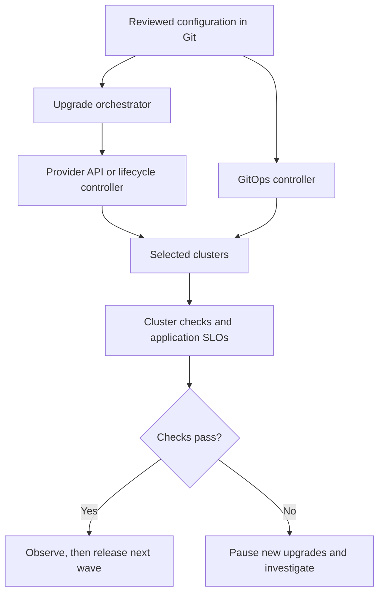

# Upgrading Hundreds of Kubernetes Clusters Without Losing Control of the Rollout

Upgrading one Kubernetes cluster is a maintenance task. Upgrading hundreds is a coordination problem: different versions, different workloads, shared dependencies, and enough variation for a successful test on one cluster to miss a failure on another.

The approach I would use is to inventory the fleet, test representative clusters, upgrade in small waves, and require evidence of health before expanding the rollout. Automation should make those decisions repeatable and stop when a check fails.

Git can hold the intended configuration, but a Git commit alone does not make an upgrade safe. The process also needs an upgrade executor, clear concurrency limits, application checks, and a recovery plan that matches the platform.

## Start with an inventory, not an upgrade command

Before choosing a target version, identify what is actually running. Record the provider, region, current control-plane and worker versions, node images, installed add-ons, workload owners, and maintenance constraints for each cluster.

Group clusters by meaningful differences. Two clusters on the same Kubernetes version may behave differently if one uses a service mesh and another runs stateful workloads on a different CSI driver.

| Inventory field | Why it matters |
| --- | --- |
| Provider and cluster lifecycle tool | Determines supported upgrade paths and recovery operations |
| Control-plane and node versions | Identifies required upgrade hops and version-skew constraints |
| CNI, CSI, DNS, ingress, and service mesh versions | Exposes dependencies that can break networking or storage |
| Admission webhooks, CRDs, and operators | Finds components that may depend on removed APIs or changed behavior |
| Node OS, architecture, runtime, and image | Identifies different replacement and compatibility requirements |
| Critical workloads and ownership | Establishes who validates the application and handles failures |
| Capacity, quotas, and disruption budgets | Determines whether nodes can be drained and replaced |
| Backup and restore status | Establishes whether the proposed recovery path has been tested |

Use explicit contexts when collecting information or making changes:

```bash
cluster_context=prod-payments-ap-south-1

kubectl --context "$cluster_context" version -o yaml
kubectl --context "$cluster_context" get nodes -o wide
kubectl --context "$cluster_context" get deployments,daemonsets,statefulsets -A
kubectl --context "$cluster_context" get pdb -A
```

These commands are a starting point. They do not replace provider inventory, image metadata, or application dependency records.

## Check compatibility before touching the control plane

For each group of similar clusters, build a compatibility matrix for the current and target Kubernetes versions. Include Helm charts, CNI and CSI drivers, ingress, monitoring, autoscaling, service meshes, custom controllers, and admission webhooks.

The important question is whether each component works throughout the transition. Some components need a bridge version that supports both the old and new Kubernetes releases before the control plane is upgraded.

### Find deprecated and removed API usage

Kube No Trouble and Pluto can help find API versions that need attention. **`kubent` is the command for Kube No Trouble**, so these are two tools, not three.

Scan the source manifests and rendered templates as well as what you can discover in the live cluster. For example:

```bash
# Requires Pluto and Helm to be installed.
mkdir -p rendered

helm template payments ./charts/payments \
  --namespace payments \
  --values environments/production.yaml \
  > rendered/payments.yaml

pluto detect-files -d rendered
```

Use the target-version options supported by your installed scanner release. Confirm that its rules cover the Kubernetes version you intend to use.

A clean scan is useful evidence, not complete proof. Controllers and external clients can still call old APIs. Review API usage metrics or audit records where available, and test reconciliation, admission, scaling, and scheduled jobs on the target version.

### Follow the supported upgrade path

Do not assume that a control plane can jump several minor releases. For kubeadm, skipping minor versions is unsupported; managed providers have their own supported paths and prerequisites.

Worker kubelets must not be newer than the API servers they communicate with. The upstream version-skew policy also constrains other components, and providers can impose stricter requirements. Check those rules for every upgrade hop instead of treating the maximum upstream skew as an operating target.

## Use representative canaries and bounded waves

A lab cluster proves that the mechanics can work. A production canary tests whether they work with real traffic, integrations, and operational constraints.

Choose canaries that represent the fleet's differences: providers, regions, network plugins, node architectures, and workload types. One small stateless cluster cannot validate an upgrade for every storage-heavy or service-mesh-enabled cluster.

For a fleet of 300 production clusters, an illustrative rollout could be:

| Stage | Clusters in this stage | Cumulative production total | Purpose |
| --- | ---: | ---: | --- |
| Lab, development, and QA | Separate from production | 0 | Rehearse upgrades, failures, and recovery |
| Production canary | 1 | 1 | Validate one representative production path |
| Additional canaries | 4 | 5 | Cover important differences in the fleet |
| Wave 1 | 15 | 20 | Expand with limited exposure |
| Wave 2 | 40 | 60 | Continue after application validation |
| Wave 3 | 80 | 140 | Expand while retaining concurrency limits |
| Wave 4 | 160 | 300 | Complete the remaining approved groups |

These numbers are an example, not a required formula. A wave of 80 clusters does not mean upgrading all 80 simultaneously. Start with a small concurrency limit and account for region, service, and dependency boundaries.

Avoid upgrading every cluster serving the same critical service or failover pair together. Separate clusters can still share a database, ingress dependency, identity service, or regional capacity limit.

After each wave, observe enough traffic and scheduled activity to judge the result. A 30-minute observation period may cover a busy API but miss a nightly job. Pick the observation period around the workload.

## Separate GitOps from cluster lifecycle management

GitOps tools and cluster lifecycle tools have related but different jobs:

| Responsibility | Example tooling |
| --- | --- |
| Store and review desired versions and configuration | Git and pull requests |
| Provision or upgrade cluster infrastructure | Provider APIs, Terraform, or Cluster API with a suitable provider |
| Distribute application and add-on configuration | Argo CD, ApplicationSet, or Flux |
| Select upgrade targets and limit concurrency | A fleet service or upgrade orchestrator with the required capabilities |
| Decide whether to advance | Automated checks, monitoring, and the rollout workflow |

Argo CD ApplicationSet generates Argo CD Applications for selected targets. It does not upgrade a managed Kubernetes control plane by itself. It can deliver lifecycle resources to an appropriate controller, but that controller must implement the actual infrastructure operations.

Similarly, a fleet product that distributes manifests is not automatically a control-plane upgrade system. Check its capabilities for your provider and cluster type.

One practical design keeps a reviewed fleet inventory in Git. The orchestrator reads that inventory, selects an approved group, and calls the appropriate provider or lifecycle controller. Application and add-on configuration continues through GitOps.



Persist rollout progress outside the lifetime of a single CI job. Track each cluster's phase, provider operation ID, last successful check, and failure reason. After a retry or runner restart, reconcile the actual state before submitting another operation.

## Upgrade each cluster in a tested order

There is no universal rule that every add-on must be upgraded after the control plane. Use the compatibility matrix to decide which changes belong before or after it.

A common sequence is:

1. Resolve removed API usage and install any required bridge versions of add-ons or webhooks.
2. Verify backup recovery, spare capacity, quotas, and application disruption tolerance.
3. Upgrade the control plane using the supported procedure, preserving quorum where you manage it yourself.
4. Validate API access and controller behavior, then update remaining add-ons at their documented points.
5. Roll worker pools to compatible node versions and images.
6. Validate applications, record the result, and observe before advancing.

Keep unrelated application releases out of the upgrade window where possible. Compatibility changes should be prepared beforehand so a new application feature does not obscure an infrastructure regression.

For managed services, wait for the provider operation to complete and inspect its result. A successful API submission only means the request was accepted.

## Replace or maintain nodes without overrunning the application

For managed or immutable node pools, a common approach is to add new capacity, verify it, drain old nodes gradually, and retire them. This keeps the replacement image predictable and avoids modifying long-lived machines unnecessarily.

Replacement still requires quota, available IP addresses, compatible instance capacity, and enough space for displaced Pods. A new node being Ready does not prove a stateful workload can attach its volume there.

Node replacement is not the only valid method. Self-managed clusters may use a supported node maintenance procedure. In either case, drain workloads before a minor kubelet upgrade and follow the platform's documented steps.

### Check disruption budgets first

Suppose `payments` runs three replicas and should retain two available replicas during voluntary disruption:

```yaml
apiVersion: policy/v1
kind: PodDisruptionBudget
metadata:
  name: payments
  namespace: payments
spec:
  minAvailable: 2
  selector:
    matchLabels:
      app: payments
```

This assumes those labels match the intended Pods and that the replicas are healthy. Spread replicas across nodes and failure domains. A PDB limits eligible evictions; it does not create spare capacity, protect against every failure, or guarantee zero downtime.

Before draining a node:

```bash
cluster_context=prod-payments-ap-south-1
node_name=worker-01

kubectl --context "$cluster_context" get pdb -A
kubectl --context "$cluster_context" get pods -A \
  --field-selector "spec.nodeName=$node_name" -o wide

kubectl --context "$cluster_context" drain "$node_name" \
  --ignore-daemonsets \
  --timeout=15m
```

`drain` marks the node unschedulable, so a separate `cordon` is usually unnecessary. `--ignore-daemonsets` allows draining to proceed without evicting DaemonSet Pods; those workloads still need handling as part of the node's retirement.

If drain blocks, investigate the reason. Common causes include a restrictive PDB, unhealthy replicas, unmanaged Pods, or `emptyDir` data. Do not add `--force`, `--disable-eviction`, or `--delete-emptydir-data` as a standard workaround. These flags address different conditions and can bypass protections or permit data loss.

After an in-place maintenance operation, verify node health before returning it to service:

```bash
kubectl --context "$cluster_context" wait \
  --for=condition=Ready "node/$node_name" --timeout=10m
kubectl --context "$cluster_context" uncordon "$node_name"
```

For replacement workflows, retire the old machine through its owning node-pool or infrastructure controller after the required checks. Do not uncordon a node that is meant to be removed. If the provider already handles rolling replacement and draining, use its controls rather than running a competing manual drain loop.

## Make health gates specific enough to stop a bad rollout

`kubectl get pods -A` is useful for inspection, but it is not an application acceptance test. A fleet gate should compare the upgraded cluster with its pre-upgrade baseline and evaluate the paths users depend on.

| Area | Example acceptance check |
| --- | --- |
| Control plane | Provider operation completed; API requests and controllers behave normally |
| Nodes | Expected capacity is present; target versions and images are correct; no unexpected pressure |
| Networking | Pod-to-Pod traffic, service discovery, ingress, and required egress succeed |
| Storage | Representative volumes attach, mount, and support expected reads and writes |
| Platform services | DNS, CNI, CSI, admission webhooks, mesh, and monitoring work |
| Applications | Critical Deployments and StatefulSets recover; synthetic transactions succeed |
| SLOs | Error rate, latency, and error-budget burn stay within the agreed limits |

For example, this Bash snippet provides a few checks for one cluster:

```bash
set -euo pipefail

: "${CLUSTER_CONTEXT:?Set the target kubeconfig context}"
: "${SMOKE_URL:?Set the application readiness URL}"

kubectl --context "$CLUSTER_CONTEXT" wait \
  --for=condition=Ready nodes --all --timeout=10m

kubectl --context "$CLUSTER_CONTEXT" rollout status \
  deployment/coredns -n kube-system --timeout=5m

kubectl --context "$CLUSTER_CONTEXT" rollout status \
  deployment/payments -n payments --timeout=5m

curl --fail --silent --show-error \
  --connect-timeout 5 --max-time 20 "$SMOKE_URL"
```

Adjust resource names to your distribution. These checks do not verify expected node count, storage behavior, or sustained SLO compliance. The URL check exercises the path from the runner, so confirm that it reaches the upgraded cluster rather than another healthy cluster behind a global load balancer.

Add a synthetic business transaction that covers the relevant service and data paths, with controlled test data and cleanup. Then evaluate monitoring over an observation period. A readiness endpoint returning HTTP 200 once is not enough to release the next wave.

If monitoring data is missing or a required check cannot run, stop promotion. Missing evidence should not count as success.

## Decide recovery options before the upgrade

“Rollback if necessary” is too vague for a cluster upgrade. Control planes, nodes, applications, and data have different recovery procedures.

| Failure | Possible response | Constraint |
| --- | --- | --- |
| Add-on incompatibility | Install a compatible version | Must support the current control plane and configuration |
| Bad node image | Replace affected nodes with a known-good compatible image | The provider may not support downgrading an existing node group |
| Application regression | Revert application configuration through Git | Does not undo incompatible schema or data changes |
| Control-plane regression | Use an explicitly supported rollback, apply a forward fix, or migrate workloads | Availability and restrictions depend on the platform |
| Data corruption or loss | Restore through the tested data recovery procedure | Recovery time and data-loss limits still apply |

Do not assume managed control planes can always be downgraded. Do not assume they can never be downgraded either: provider capabilities change. For example, current Amazon EKS documentation describes rollback to the previous minor version within seven days of an eligible upgrade, with prerequisites for nodes, add-ons, and enabled features. Verify eligibility for the specific cluster before relying on it.

For self-managed clusters, an etcd snapshot is part of a recovery procedure, not a universal downgrade button. Restoring cluster state does not restore application volume contents. Managed services also do not generally expose customer-controlled etcd restoration as a recovery interface.

With GitOps, a direct Helm or Argo CD rollback may conflict with the desired state still stored in Git. Revert the relevant configuration and coordinate reconciliation. Workload rollback also needs a separate decision about database migrations and writes made since the change.

When a gate fails, stop launching new cluster upgrades, inspect operations already in progress, and follow the recovery plan. Pausing the fleet does not necessarily cancel a provider operation that has already started.

## Keep the outcome reviewable

For every upgraded cluster, retain the source and target versions, node images, add-on versions, start and completion times, provider operation IDs, validation results, and any incident notes. Record exceptions rather than silently treating a partially upgraded cluster as complete.

That record makes the next wave easier to assess and the next upgrade easier to plan. It also tells another engineer where to resume if the original operator or CI runner is unavailable.

## A concise interview answer

> For hundreds of clusters, I would group the fleet by provider, configuration, and workload risk, then use representative canaries followed by bounded upgrade waves. Before each upgrade, I would check API removals, add-on compatibility, capacity, disruption budgets, and recovery readiness. A lifecycle controller or provider API performs the infrastructure upgrade; GitOps manages the reviewed configuration and workload changes. Each wave advances only after cluster checks, synthetic transactions, and application SLOs pass. If a gate fails, I stop new upgrades and use the recovery path supported by that platform.

## References

- [Kubernetes version-skew policy](https://kubernetes.io/releases/version-skew-policy/)
- [Upgrading kubeadm clusters](https://kubernetes.io/docs/tasks/administer-cluster/kubeadm/kubeadm-upgrade/)
- [kubectl drain reference](https://kubernetes.io/docs/reference/kubectl/generated/kubectl_drain/)
- [PodDisruptionBudget configuration](https://kubernetes.io/docs/tasks/run-application/configure-pdb/)
- [Kube No Trouble](https://github.com/doitintl/kube-no-trouble)
- [Pluto quickstart](https://pluto.docs.fairwinds.com/quickstart/)
- [Argo CD ApplicationSet](https://argo-cd.readthedocs.io/en/stable/user-guide/application-set/)
- [Cluster API upgrade workflows](https://cluster-api.sigs.k8s.io/tasks/upgrading-clusters.html)
- [Amazon EKS cluster upgrades](https://docs.aws.amazon.com/eks/latest/userguide/update-cluster.html)
- [Amazon EKS version rollback](https://docs.aws.amazon.com/eks/latest/userguide/rollback-cluster.html)
