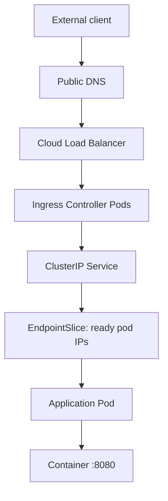
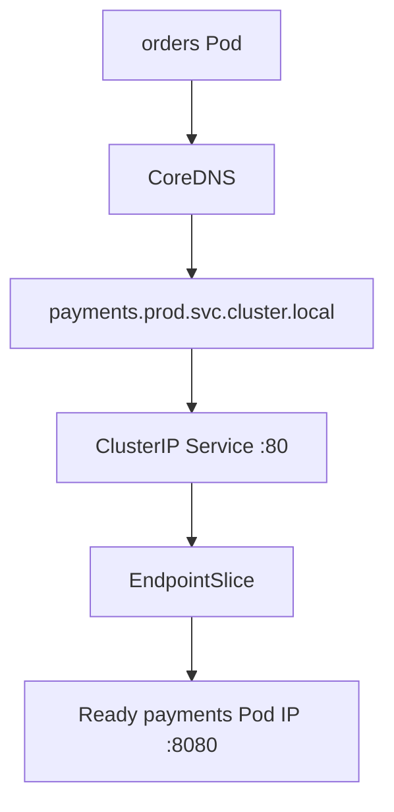
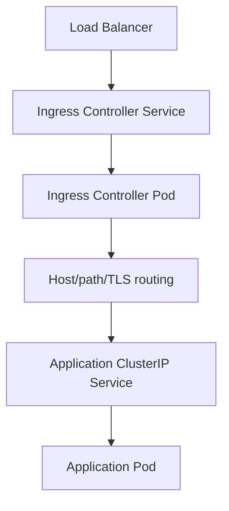
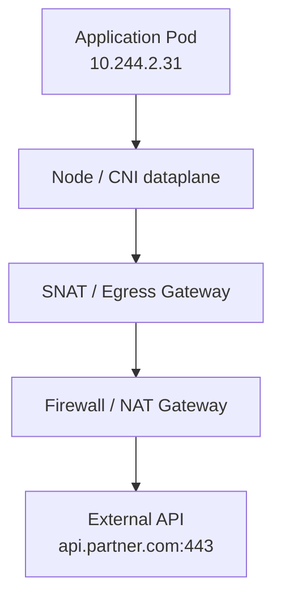

# Networking inside kubernetes

Inside Kubernetes, networking has two separate paths:

1. **Pod-to-Pod / Service-to-Service traffic inside the cluster**
2. **External traffic entering through Load Balancer and Ingress**



## Core internal networking

### 1. Pod network

Every Pod gets its own routable IP from the cluster CNI.

```text
Pod A: 10.244.1.18
Pod B: 10.244.2.31
```

- Pods communicate directly using Pod IPs.
- Containers within the **same Pod** share one network namespace and IP.
  - App can call sidecar on `localhost`.
- Pods on different nodes communicate through the CNI network.
  - Examples: Cilium, Calico, Flannel, AWS VPC CNI, Azure CNI.
- Pod IPs are ephemeral. Never hardcode them.

### 2. Kubernetes Service

A Service provides a stable internal DNS name and virtual IP for changing Pod IPs.

```text
payments.prod.svc.cluster.local
```

```yaml
apiVersion: v1
kind: Service
metadata:
  name: payments
  namespace: prod
spec:
  type: ClusterIP
  selector:
    app: payments
  ports:
    - name: http
      port: 80
      targetPort: 8080
```

Internal call:

```text
orders → http://payments.prod.svc.cluster.local:80
```

Flow:



The Service selects only Pods that:

- match its label selector
- are considered ready by their readiness probe
- are registered in its EndpointSlice

### 3. EndpointSlice

`EndpointSlice` is the actual Service-to-Pod mapping.

```bash
kubectl -n prod get endpointslice -l kubernetes.io/service-name=payments
```

Example outcome:

```text
Service: payments
Endpoints:
  10.244.1.18:8080
  10.244.2.31:8080
  10.244.3.12:8080
```

If this list is empty, the Service cannot route traffic.

Common reasons:

- Service selector does not match Pod labels.
- Pods are not ready.
- wrong namespace
- port name or `targetPort` mismatch

### 4. How Service routing works

A `ClusterIP` is virtual. It is not normally assigned to an application Pod.

The node routes Service traffic using one of:

- `kube-proxy` with iptables
- `kube-proxy` with IPVS
- eBPF dataplane, commonly Cilium

Conceptually:

```text
payments Service IP: 10.96.115.20:80
        ↓
chosen ready endpoint: 10.244.2.31:8080
```

The source Pod sends traffic to the Service IP, and the dataplane translates it to one selected backend Pod endpoint.

Important: the Service load-balances at connection level. One persistent HTTP/2, gRPC, or keep-alive connection may remain on one Pod longer than expected.

---

## Ingress networking

Ingress is an HTTP/HTTPS routing rule. It does not expose an application by itself. An **Ingress controller** implements it.



Example:

```yaml
apiVersion: networking.k8s.io/v1
kind: Ingress
metadata:
  name: payments
  namespace: prod
spec:
  ingressClassName: nginx
  rules:
    - host: api.company.com
      http:
        paths:
          - path: /payments
            pathType: Prefix
            backend:
              service:
                name: payments
                port:
                  number: 80
```

Request path:

```text
https://api.company.com/payments/orders
  → Load Balancer
  → NGINX/ALB Ingress Controller
  → prod/payments Service:80
  → selected ready payments Pod:8080
```

Ingress controller and application service are separate workloads.

```text
ingress-nginx namespace
  ingress-nginx-controller Service
  ingress-nginx-controller Pods

prod namespace
  payments Service
  payments Pods
```

---

## Service types

| Type | Reachability | Typical use |
|---|---|---|
| `ClusterIP` | Internal cluster only | Default for APIs, databases, workers |
| `Headless` (`clusterIP: None`) | DNS returns individual Pod IPs | StatefulSets, direct discovery |
| `NodePort` | Node IP plus fixed port | Usually infrastructure integration, not primary enterprise ingress |
| `LoadBalancer` | Cloud/provider LB to a Service | Expose Ingress controller, private endpoints |
| `ExternalName` | DNS alias to external hostname | Controlled integration to external service |

Enterprise default:

```text
Internet → public LoadBalancer → Ingress Controller → ClusterIP Service → Pods
Internal service → ClusterIP Service → Pods
```

---

## Internal DNS

CoreDNS creates Service records.

Within the same namespace:

```text
http://payments
```

Across namespaces:

```text
http://payments.prod
```

Fully qualified:

```text
http://payments.prod.svc.cluster.local
```

Check it from a Pod:

```bash
nslookup payments.prod.svc.cluster.local
```

DNS provides the Service IP for a normal ClusterIP Service, not individual application Pod IPs.

---

## NetworkPolicy: who may talk to whom

Without NetworkPolicies, many CNIs allow Pod-to-Pod traffic across namespaces by default.

Use default deny, then explicit allow rules.

```yaml
apiVersion: networking.k8s.io/v1
kind: NetworkPolicy
metadata:
  name: allow-ingress-to-payments
  namespace: prod
spec:
  podSelector:
    matchLabels:
      app: payments
  policyTypes:
    - Ingress
  ingress:
    - from:
        - namespaceSelector:
            matchLabels:
              kubernetes.io/metadata.name: ingress-nginx
      ports:
        - protocol: TCP
          port: 8080
```

This permits Ingress-controller Pods to reach `payments` Pods on `8080`.

Also allow required traffic for:

- DNS to CoreDNS, TCP/UDP 53
- observability agents and collectors
- service mesh control/data-plane requirements
- Prometheus scraping
- egress to databases, queues, third-party APIs, and cloud metadata where needed

A NetworkPolicy only works if the selected CNI enforces it.

---

## Health checks control routing

```text
startupProbe    → app has started
readinessProbe  → Service may send new traffic
livenessProbe   → restart a stuck container
```

For safe deployments and rollback:

- Set readiness to fail before terminating a Pod.
- Use a termination grace period long enough for in-flight requests.
- Configure load balancer/controller connection draining.
- Ensure the application stops accepting new work after `SIGTERM`.
- Do not use liveness probes for dependency outages, or Kubernetes may restart all Pods during a downstream incident.

---

## Debug order

```bash
kubectl -n prod get ingress payments
kubectl -n prod describe ingress payments

kubectl -n prod get svc payments
kubectl -n prod get endpointslice -l kubernetes.io/service-name=payments

kubectl -n prod get pods -l app=payments
kubectl -n prod describe pod <payments-pod>

kubectl -n ingress-nginx get pods
kubectl -n ingress-nginx logs deploy/ingress-nginx-controller
```

The key model is:

```text
Ingress decides HTTP host/path routing.
Service provides stable discovery and load balancing.
EndpointSlice lists eligible Pod targets.
CNI carries Pod traffic across nodes.
NetworkPolicy restricts allowed Pod traffic.
Readiness decides whether a Pod receives new Service traffic.
```

### Pod to External network traffic flow

Pod-to-external traffic is **egress**.



Example:

```text
payments Pod
  → DNS resolves api.stripe.com
  → TCP/TLS connection leaves the cluster
  → source Pod IP is usually SNATed
  → external provider sees a node, NAT Gateway, or egress-gateway IP
```

## What happens technically

1. The Pod resolves the external hostname through CoreDNS.

```text
api.partner.com → external IP address
```

2. The Pod sends traffic to that external IP through its CNI route.

3. The CNI/node forwards it outside the Pod network.

4. Source NAT usually happens because Pod IP ranges are not publicly routable.

```text
Pod IP:        10.244.2.31
External sees: 203.0.113.18
```

5. Return traffic reaches the egress IP. Connection tracking reverses NAT and returns traffic to the original Pod.

## Enterprise egress patterns

| Pattern | Source IP seen by external system | Use |
|---|---|---|
| Node SNAT | Node public/private egress IP | Simple clusters, least control |
| Cloud NAT Gateway | Shared fixed NAT public IP | Standard controlled internet egress |
| Egress Gateway | Dedicated gateway IP per namespace/workload | Strong control, auditing, partner IP allowlists |
| Proxy | Proxy IP | HTTP/S inspection, identity, policy, logging |
| Private endpoint | Private internal IP | Cloud-managed services without public internet |

For payment providers, SaaS allowlists, and regulated systems, use a **stable egress IP**, normally NAT Gateway or egress gateway. Do not make a partner allowlist every Kubernetes node IP.

## NetworkPolicy egress control

Default deny egress, then permit only required destinations.

```yaml
apiVersion: networking.k8s.io/v1
kind: NetworkPolicy
metadata:
  name: payments-egress
  namespace: prod
spec:
  podSelector:
    matchLabels:
      app: payments
  policyTypes:
    - Egress
  egress:
    # CoreDNS
    - to:
        - namespaceSelector:
            matchLabels:
              kubernetes.io/metadata.name: kube-system
      ports:
        - protocol: UDP
          port: 53
        - protocol: TCP
          port: 53

    # Example fixed external IP only
    - to:
        - ipBlock:
            cidr: 198.51.100.24/32
      ports:
        - protocol: TCP
          port: 443
```

Important limitation: standard Kubernetes `NetworkPolicy` is IP-based. It cannot reliably enforce “allow `api.partner.com`” because external DNS IPs can change.

For domain-aware policy, use:

- Cilium FQDN policies
- an egress proxy such as Envoy/Squid
- cloud firewall policy with DNS/FQDN support
- a service mesh egress gateway

## Recommended staff-level design

```text
Workload namespace
  → default-deny NetworkPolicy
  → allow DNS only
  → allow explicit internal dependencies
  → HTTPS through egress gateway/proxy
  → NAT Gateway with fixed public IP
  → cloud firewall / threat controls
  → external destination
```

Require for each permitted external dependency:

- owner and business purpose
- FQDN and ports
- fixed IP or domain-aware enforcement method
- timeout, retry, circuit-breaker, and rate-limit policy
- mTLS/API credential storage and rotation method
- egress logs, metrics, and alerts
- data classification and allowed outbound fields

## Quick troubleshooting

```bash
kubectl -n prod exec deploy/payments -- nslookup api.partner.com
kubectl -n prod exec deploy/payments -- curl -sv --connect-timeout 5 https://api.partner.com
kubectl -n prod get networkpolicy
kubectl -n kube-system get pods
```

If DNS works but `curl` times out, check egress NetworkPolicy, CNI routes, node/NAT gateway routes, cloud firewall/security groups, and the provider’s IP allowlist.