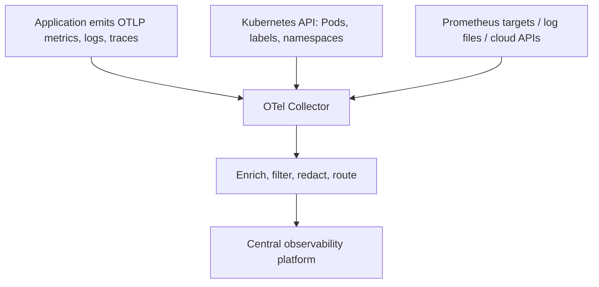

# How Does the OpenTelemetry Collector Know What to Collect in Kubernetes?

# How Does the OpenTelemetry Collector Know What to Collect in Kubernetes?

You deploy an OpenTelemetry Collector into a cluster, and telemetry starts showing up in your backend tagged with Pod names, namespaces, and Deployments. Nobody told the collector what your application does, so where does that knowledge come from?

It doesn't come from anywhere. The collector understands nothing about your application. Everything it knows comes from three places:

1. **Application instrumentation:** what the app chooses to emit
2. **Kubernetes discovery:** where the data came from, via the Kubernetes API
3. **Collector configuration:** what gets received, enriched, filtered, and routed



This post walks through each signal and where its meaning is defined. The configs target recent `otelcol-contrib` releases. The `container` log parser needs a mid-2024 or later version, and the components used here ship in the **contrib** distribution, not core.

## 1. The application pushes OTLP

The app uses an OpenTelemetry SDK or auto-instrumentation agent and exports to the collector:

```text
Application → OTLP endpoint → Collector receiver
```

```yaml
env:
  - name: OTEL_SERVICE_NAME
    value: orchestrator
  - name: OTEL_EXPORTER_OTLP_ENDPOINT
    value: http://otel-collector.observability:4318
  - name: OTEL_EXPORTER_OTLP_PROTOCOL
    value: http/protobuf
  - name: OTEL_RESOURCE_ATTRIBUTES
    value: deployment.environment=prod,cloud.region=ap-south-1
```

Port 4318 is OTLP/HTTP and 4317 is OTLP/gRPC. Set the protocol explicitly, because SDK defaults differ between languages and a mismatch is a common cause of silently missing data.

The app sends request durations, status codes, DB query latency, external API timeouts, exception types, and trace IDs. The collector needs no knowledge of your source code because the wire format is standardized. What gets emitted is entirely the application team's decision.

## 2. Kubernetes tells the collector who sent it

The `k8sattributes` processor watches the Kubernetes API and attaches workload metadata to incoming telemetry:

```text
Source IP 10.244.2.31
→ Pod: orchestrator-7d89cc9f76-k8zjl
→ Namespace: prod
→ Deployment: orchestrator
→ Labels: app=orchestrator
```

Details that matter:

- It uses informers and a local cache, not a per-request API lookup. The cost is memory, not API load.
- By default it associates telemetry to Pods by connection IP. Behind proxies or sidecars, and for log records, configure association explicitly by resource attribute (`k8s.pod.uid`, `k8s.pod.ip`).
- Its ServiceAccount needs `get/list/watch` on Pods and Namespaces. Some Deployment-level attributes also need ReplicaSets, depending on version.
- Labels and annotations are not copied by default. You opt in with `extract.labels` and `extract.annotations`.
- It does not set `k8s.cluster.name` or `cloud.region`. Add those with the `resource` or `resourcedetection` processor.

This is why labels matter. Consistent `app`, `version`, and `team` labels let you group telemetry by service, region, or tenant without developers hand-tagging every signal.

## 3. Metrics: scrape discovery

Prometheus-style metrics are pulled, not pushed. The collector's `prometheus` receiver runs Prometheus service discovery against the Kubernetes API.

The classic pattern is annotation-based:

```yaml
metadata:
  labels:
    app: orchestrator
  annotations:
    prometheus.io/scrape: "true"
    prometheus.io/path: "/metrics"
    prometheus.io/port: "8080"
```

These annotations are a convention, not a Kubernetes feature. They do nothing unless your relabel rules honor them. Beyond a small cluster, explicit `ServiceMonitor` or `PodMonitor` resources are better:

```yaml
apiVersion: monitoring.coreos.com/v1
kind: ServiceMonitor
metadata:
  name: orchestrator
  namespace: observability
spec:
  namespaceSelector:
    matchNames: [prod]
  selector:
    matchLabels:
      app: orchestrator
  endpoints:
    - port: metrics
      path: /metrics
      interval: 30s
```

Two caveats most tutorials skip:

- `ServiceMonitor` and `PodMonitor` are Prometheus Operator CRDs. The collector's Prometheus receiver does not read them on its own. With the OpenTelemetry Operator, the **Target Allocator** consumes them and distributes scrape targets across collector replicas.
- If every collector replica runs the same `kubernetes_sd_configs`, every replica scrapes every matching Pod and you get duplicate series. Run scraping in a single replica, or shard it with the Target Allocator. Never put a cluster-wide scrape config in a DaemonSet.

## 4. Logs: tailing node files

Container stdout/stderr lands in files on the node. A DaemonSet collector tails them with the `filelog` receiver:

```text
Container stdout/stderr
→ /var/log/pods/<ns>_<pod>_<uid>/<container>/*.log
→ filelog receiver (container parser)
→ k8sattributes enrichment
→ backend
```

The log path encodes namespace, Pod name, UID, and container, so the source can be identified from the file alone. `k8sattributes` fills in the rest from the API.

The application requirement is simple: **write structured logs to stdout**. Logs written only to files inside the container are invisible to this pipeline unless you add a sidecar or volume mount. The DaemonSet itself needs a read-only `hostPath` mount of `/var/log/pods`.

## 5. Traces: context propagation

A single request crosses several services:

```text
Robot request → Ingress → Orchestrator → Database → External finance API
```

Each hop propagates the W3C trace context header:

```text
traceparent: 00-<trace-id>-<span-id>-01
```

Every service exports its own spans. The backend stitches the full trace together by `trace_id`, and the collector's job is to receive, enrich, and forward them.

Correlation across signals depends on the app too. Logs link to traces only if the application stamps `trace_id` and `span_id` onto log records, through the SDK log bridge or your logging framework's OTel integration. Metrics link to traces through exemplars or shared resource attributes such as service, version, and region.

## 6. Business metrics must be defined explicitly

Infrastructure and RED metrics come almost for free. Domain metrics do not. A collector cannot infer that "oldest queue item age" matters from a generic API response.

For platform-specific measures such as queue depth, failed jobs, or connected agents, one of these has to exist:

- The platform exposes a metrics endpoint.
- The platform API exposes the data and a custom exporter converts it to metrics.
- The platform emits structured logs that can be parsed into events.

A custom exporter might expose:

```text
orchestrator_connected_agents{region="ap-south-1",pool="finance"} 42
orchestrator_queue_oldest_item_age_seconds{queue="invoice"} 380
orchestrator_jobs_failed_total{process="invoice-automation"} 7
```

The collector then scrapes it like any other target. Deciding which measures matter, and what they mean, is a platform-team design task, not collector magic.

## 7. Configuration decides what is accepted

Here is a per-node **agent** config, deployed as a DaemonSet. It receives OTLP from local Pods, tails container logs, enriches everything with Kubernetes metadata, and forwards to a central gateway.

```yaml
receivers:
  otlp:
    protocols:
      grpc:
        endpoint: 0.0.0.0:4317
      http:
        endpoint: 0.0.0.0:4318
  filelog:
    include: [/var/log/pods/*/*/*.log]
    exclude: [/var/log/pods/observability_*/*/*.log]
    include_file_path: true
    start_at: end
    operators:
      - type: container

processors:
  memory_limiter:
    check_interval: 1s
    limit_mib: 512
  k8sattributes:
    auth_type: serviceAccount
    pod_association:
      - sources:
          - from: resource_attribute
            name: k8s.pod.uid
      - sources:
          - from: resource_attribute
            name: k8s.pod.ip
      - sources:
          - from: connection
    extract:
      metadata:
        - k8s.namespace.name
        - k8s.pod.name
        - k8s.pod.uid
        - k8s.deployment.name
        - k8s.node.name
      labels:
        - tag_name: app
          key: app
          from: pod
  resource:
    attributes:
      - key: k8s.cluster.name
        value: prod-in-01
        action: upsert
  batch: {}

exporters:
  otlp:
    endpoint: central-telemetry-gateway.example.com:4317

service:
  pipelines:
    traces:
      receivers: [otlp]
      processors: [memory_limiter, k8sattributes, resource, batch]
      exporters: [otlp]
    metrics:
      receivers: [otlp]
      processors: [memory_limiter, k8sattributes, resource, batch]
      exporters: [otlp]
    logs:
      receivers: [otlp, filelog]
      processors: [memory_limiter, k8sattributes, resource, batch]
      exporters: [otlp]
```

Three things worth noting:

- **Explicit OTLP endpoints.** Recent collector versions bind OTLP receivers to `localhost` by default. In a Pod you must set `0.0.0.0` or nothing outside the container can reach it.
- **Explicit pod association.** Log records arrive from a file, not a network connection, so association by `k8s.pod.uid` (set by the `container` parser) is what makes enrichment work for logs.
- **Processor order.** `memory_limiter` goes first and `batch` goes last in every pipeline.

Prometheus scraping lives in a separate single-replica collector (or behind the Target Allocator), not in the DaemonSet:

```yaml
receivers:
  prometheus:
    config:
      scrape_configs:
        - job_name: orchestrator
          kubernetes_sd_configs:
            - role: pod
          relabel_configs:
            - source_labels: [__meta_kubernetes_pod_label_app]
              regex: orchestrator
              action: keep
```

In production you will also want TLS on the exporter, a retry and sending queue, and a gateway tier (a Deployment) behind the agents for filtering, redaction, tail sampling, and routing.

## Who owns what

| Team | Defines |
|---|---|
| Application | Instrumentation, structured logs, trace propagation, business metrics |
| Platform | Collector deployment, discovery, metadata enrichment, routing, reliability |
| SRE | Dashboards, SLOs, alert thresholds, runbooks |
| Security | Redaction, retention, access control, audit requirements |

## The takeaway

```text
Where telemetry comes from → collector config + Kubernetes discovery
What telemetry means       → instrumentation, labels, defined business metrics
```

A collector is a pipeline, not an observer. If the output is missing context, the fix is almost always upstream: better instrumentation, consistent labels, or an explicit metric definition.
