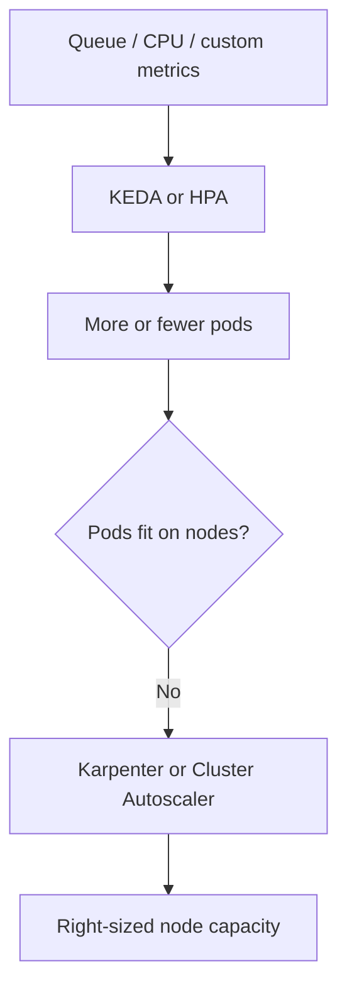

```Explain Kubernetes autoscaling in depth for interview preparation, using a realistic Enterprise platform example (no proprietary claims). Cover and compare Karpenter, KEDA, HPA, VPA, and Cluster Autoscaler: purpose, architecture, scaling flow, configuration, key YAML examples, metrics, limitations, best use cases, cost/reliability impact, and common production issues. Show how they work together to improve efficiency, reduce waste, and maintain availability. Include cluster lifecycle/upgrades, platform reliability, reusable templates/paved paths, and developer self-service. End with an interview-ready STAR story, a Markdown mind map, and common interview questions with concise answers.```

## Kubernetes autoscaling: the interview mental model

In a realistic, non-proprietary Enterprise platform scenario, imagine Kubernetes hosting asynchronous integration services: they consume messages, validate/enrich them, and send results to downstream systems.

Autoscaling has three distinct jobs:

| Layer | Question | Main tools |
|---|---|---|
| Pod replicas | “How many application workers do I need?” | HPA, KEDA |
| Node capacity | “Where will those pods run?” | Karpenter, Cluster Autoscaler |
| Pod resource sizing | “How much CPU and memory should each pod request?” | VPA |

The strongest interview answer is: **KEDA/HPA add or remove pods; Karpenter/Cluster Autoscaler add or remove nodes; VPA recommends or adjusts pod resource requests.**



## Tool comparison

| Tool | Primary purpose | Scaling signal | Strength | Main limitation | Best fit |
|---|---|---|---|---|---|
| HPA | Scale pod replicas | CPU, memory, custom/external metrics | Native Kubernetes, simple, reliable | Does not create nodes; CPU alone may not represent demand | Stateless APIs and workers |
| KEDA | Event-driven pod scaling | Queue depth, lag, streams, Prometheus, external systems | External triggers and scale-to-zero | Requires correct trigger thresholds and safe cold-start behavior | Queue consumers, scheduled/event workloads |
| Cluster Autoscaler | Add/remove node groups | Pending, unschedulable pods | Mature and predictable with fixed node groups | Constrained by preconfigured node-group shapes | Stable, standardized capacity pools |
| Karpenter | Dynamically provision right-sized nodes | Pending pods and scheduling constraints | Flexible instance/node selection and consolidation | Requires careful disruption, networking, and instance-policy guardrails | Variable workloads and efficient bin packing |
| VPA | Right-size pod requests | Historical usage | Reduces over/under-requesting | Can restart pods in Auto mode; not ideal for all workloads | Long-running workloads with uncertain sizing |

Kubernetes documents HPA, VPA, and node autoscaling as separate workload-autoscaling concepts; they should be designed together rather than treated as interchangeable. [Kubernetes autoscaling documentation](https://kubernetes.io/docs/concepts/workloads/autoscaling/)

## How each component works

### HPA: replica scaling from resource or application metrics

HPA periodically compares observed metric values to a target and changes the target workload’s desired replicas.

Simplified CPU calculation:

\[
desiredReplicas = currentReplicas \times \frac{currentMetric}{targetMetric}
\]

Example: 10 pods running at 120% of a 60% CPU target suggests:

\[
10 \times \frac{120}{60} = 20 \text{ pods}
\]

```yaml
apiVersion: autoscaling/v2
kind: HorizontalPodAutoscaler
metadata:
  name: api-service
spec:
  scaleTargetRef:
    apiVersion: apps/v1
    kind: Deployment
    name: api-service
  minReplicas: 3
  maxReplicas: 20
  behavior:
    scaleDown:
      stabilizationWindowSeconds: 300
  metrics:
    - type: Resource
      resource:
        name: cpu
        target:
          type: Utilization
          averageUtilization: 60
```

Use HPA for an API when CPU, memory, request rate, concurrency, or latency is a reasonable proxy for work.

Key metrics:

- CPU/memory utilization
- Requests per second
- In-flight requests or concurrency
- p95 latency and error rate
- Replica count and throttling

Production concern: CPU-based HPA can fail for I/O-bound workloads, where pods wait on external dependencies rather than consume CPU. Prefer an application metric in that case.

---

### KEDA: event-driven scaling

KEDA creates or manages HPA behavior from external event sources. For a message consumer, it can scale based on queue backlog rather than CPU utilization. It can also safely scale eligible workloads to zero. Its `ScaledObject` defines the target workload, trigger, and minimum/maximum replica behavior. [KEDA ScaledObject reference](https://keda.sh/docs/2.20/reference/scaledobject-spec/)

```yaml
apiVersion: keda.sh/v1alpha1
kind: ScaledObject
metadata:
  name: integration-worker
spec:
  scaleTargetRef:
    name: integration-worker
  minReplicaCount: 0
  maxReplicaCount: 30
  pollingInterval: 15
  cooldownPeriod: 120
  triggers:
    - type: prometheus
      metadata:
        serverAddress: http://prometheus.monitoring.svc:9090
        metricName: integration_queue_depth
        query: sum(integration_queue_messages_ready)
        threshold: "25"
```

Interpretation: KEDA adds worker pods as the queue rises, roughly targeting 25 queued messages per replica. The exact threshold should be based on measured worker throughput, message duration, downstream limits, and the backlog SLO.

Best practices:

- Use queue age/lag as well as queue depth when possible.
- Make handlers idempotent; retries and duplicate delivery are normal in distributed systems.
- Set `terminationGracePeriodSeconds` so a worker can finish or safely release work.
- Keep a nonzero `minReplicaCount` when cold starts threaten an availability or latency objective.
- Rate-limit consumers when downstream systems have strict capacity limits.

---

### Cluster Autoscaler: scale fixed node groups

Cluster Autoscaler watches for pods that remain Pending because no node has enough available resources or the required labels/taints/affinity. It then increases an eligible, preconfigured node group. During low usage, it drains and removes nodes that can be safely evicted.

```yaml
# Illustrative node-group intent, commonly managed through IaC
nodeGroups:
  - name: general-workers
    minSize: 3
    maxSize: 30
    instanceTypes: ["m-family.large"]
    labels:
      workload-tier: general
```

Strengths:

- Easy to reason about when node groups are intentionally fixed.
- Strong fit for regulated or standardized fleets with a small approved instance catalog.
- Good operational maturity.

Trade-off: it chooses among already-defined node groups. If pod shapes vary greatly, fixed node groups can leave fragmented, paid-for capacity.

---

### Karpenter: dynamic, right-sized node provisioning

Karpenter reacts to unschedulable pods and provisions nodes that satisfy their aggregate requests, scheduling rules, approved instance families, architecture, zones, and capacity constraints. It can also consolidate empty or underutilized nodes. Its disruption settings are central to safe consolidation. [Karpenter disruption documentation](https://karpenter.sh/docs/concepts/disruption/)

For an AWS-backed Kubernetes example, a simplified `NodePool` might be:

```yaml
apiVersion: karpenter.sh/v1
kind: NodePool
metadata:
  name: integration-workloads
spec:
  template:
    spec:
      requirements:
        - key: kubernetes.io/arch
          operator: In
          values: ["amd64"]
        - key: karpenter.k8s.aws/instance-category
          operator: In
          values: ["c", "m", "r"]
        - key: karpenter.k8s.aws/instance-generation
          operator: Gt
          values: ["3"]
      taints:
        - key: workload
          value: integration
          effect: NoSchedule
      nodeClassRef:
        group: karpenter.k8s.aws
        kind: EC2NodeClass
        name: platform-standard
  disruption:
    consolidationPolicy: WhenEmptyOrUnderutilized
    consolidateAfter: 5m
  limits:
    cpu: "500"
```

Workload placement:

```yaml
spec:
  tolerations:
    - key: workload
      operator: Equal
      value: integration
      effect: NoSchedule
  resources:
    requests:
      cpu: "500m"
      memory: "1Gi"
    limits:
      cpu: "1"
      memory: "2Gi"
```

Karpenter is especially effective when requests are realistic. A pod that requests 4 CPUs but usually uses 200m may force large nodes and create apparent “capacity” waste even if its actual utilization is low.

---

### VPA: right-size requests

VPA observes historical resource use and recommends, initializes, or—in Auto mode—updates resource requests.

```yaml
apiVersion: autoscaling.k8s.io/v1
kind: VerticalPodAutoscaler
metadata:
  name: integration-worker
spec:
  targetRef:
    apiVersion: apps/v1
    kind: Deployment
    name: integration-worker
  updatePolicy:
    updateMode: "Off" # recommendation-only initially
```

A safe adoption path:

1. Start with `Off` mode and inspect recommendations.
2. Correct clear over- or under-requesting in Git-managed manifests.
3. Consider `Initial` for new pods.
4. Use `Auto` only where restarts/evictions are acceptable and disruption controls are in place.

Avoid blindly combining VPA and CPU-based HPA on the same resource target: when VPA changes CPU requests, it changes the denominator HPA uses for utilization. A safer pattern is:

- VPA for memory recommendations or initial sizing.
- HPA/KEDA for replica scaling.
- Explicitly tested behavior for any combined setup.

## How they work together

For the integration-worker example:

1. A demand spike increases queue depth.
2. KEDA raises the desired worker replica count.
3. Kubernetes schedules the new pods.
4. If existing nodes lack room, pods become Pending.
5. Karpenter provisions an approved, appropriately sized node.
6. Work is processed; queue depth falls.
7. KEDA reduces replicas after cooldown.
8. Karpenter consolidates empty or underutilized nodes, subject to disruption policy.
9. VPA recommendations continuously improve future pod requests.

For a steady API service, substitute HPA for KEDA: HPA scales replicas from CPU, request rate, or concurrency; Karpenter supplies nodes if needed.

## Cost and reliability impact

| Design choice | Efficiency impact | Reliability safeguard |
|---|---|---|
| KEDA queue-based scaling | Avoids idle workers and supports burst capacity | Backlog/lag SLOs, safe minimum replicas |
| HPA with stabilization | Matches replicas to demand | Prevents rapid scale oscillation |
| Karpenter consolidation | Reduces fragmented idle node capacity | PDBs, graceful termination, disruption budgets |
| VPA recommendations | Corrects inflated requests | Review before automatic updates |
| Requests/limits | Improves bin packing and scheduling accuracy | Prevents noisy-neighbor resource starvation |
| Dedicated NodePools | Avoids broad overprovisioning | Isolates sensitive workloads with taints/labels |

Do not promise a percentage saving unless you have measured it. Say: “We measured lower idle node-hours and better request-to-usage alignment while validating queue-age, error-rate, and availability SLOs.”

## Common production issues and fixes

| Issue | Why it happens | Practical response |
|---|---|---|
| Scaling thrash | Thresholds or cooldowns are too aggressive | Add HPA stabilization and KEDA cooldown; tune with real traffic |
| Pods Pending too long | Requests are too large, constraints conflict, or capacity is unavailable | Inspect scheduler events, relax unnecessary affinity, widen allowed instance choices |
| Queue grows despite more pods | Downstream dependency is saturated | Limit concurrency, protect downstream systems, scale the true bottleneck |
| Karpenter consolidation disrupts service | Missing PDBs or insufficient graceful shutdown | Add PDBs, probes, preStop handling, and appropriate consolidation delay |
| Scale-to-zero misses latency target | Cold start or image pull is slow | Keep baseline replicas, pre-pull images, optimize startup path |
| Incorrect HPA behavior | Metrics pipeline is missing/stale | Monitor Metrics Server/custom metrics adapter and use fallback alerts |
| VPA changes affect HPA | CPU request changes alter HPA utilization | Use VPA recommendation mode or scale HPA on external metrics |
| Upgrade breaks scaling | CRD/controller/API compatibility was not validated | Upgrade in stages; test controller, CRD, and add-on compatibility first |

## Platform engineering contributions

### Cluster lifecycle and upgrades

A platform team should treat autoscaling controllers as first-class cluster dependencies:

- Maintain a supported-version matrix for Kubernetes, Karpenter, KEDA, metrics components, CNI, CSI, and ingress.
- Test upgrades in a production-like non-production environment.
- Upgrade controllers and CRDs in documented order, using GitOps and rollback plans.
- Use canary node pools/node groups to validate scheduling, disruption, and workload compatibility.
- Track node age, upgrade compliance, failed provisioning, and pending-pod duration.

### Reliability

Define and alert on:

- Queue depth and oldest-message age
- p95/p99 processing latency and errors
- HPA/KEDA desired versus current replicas
- Pending pods and scheduler failures
- Node provisioning time and node pressure
- Evictions, restarts, PDB-blocked drains
- CPU/memory requests versus actual usage

A useful principle: **autoscaling is reliable only when the metrics, workload shutdown behavior, and capacity supply chain are reliable.**

### Reusable templates and paved paths

Provide versioned Helm charts or Kustomize bases that include:

- Standard labels, service accounts, resource requests/limits
- Readiness/liveness/startup probes
- PDBs and topology spread constraints
- HPA or KEDA templates with safe defaults
- Node affinity/toleration patterns
- Dashboards, alerts, and runbook links
- Policy checks for missing limits, unbounded replicas, or unsafe scale-to-zero

### Developer self-service

Teams should be able to select an approved scaling pattern through a pull request:

```yaml
autoscaling:
  mode: keda-queue
  minReplicas: 1
  maxReplicas: 20
  queueTargetPerPod: 25
  scaleDownCooldownSeconds: 120
```

The platform owns guardrails; product teams own workload-specific choices such as throughput targets, minimum capacity, and downstream dependency limits.

## Interview-ready STAR story

**Situation:** On a non-proprietary healthcare Kubernetes platform, asynchronous integration workers had highly variable demand. Fixed worker and node capacity created idle spend, while bursts risked delayed processing.

**Task:** Improve elasticity without compromising availability or causing unsafe node disruption.

**Action:** I introduced KEDA for queue-driven worker scaling and Karpenter for right-sized node provisioning. I first standardized CPU/memory requests, probes, PDBs, and graceful shutdown. I used GitOps-managed templates so teams could adopt a supported scaling pattern, then added dashboards for queue age, desired versus current replicas, pending pods, node provisioning time, and disruption events. For lifecycle safety, I validated controller and CRD compatibility in lower environments before cluster upgrades.

**Result:** The platform aligned pod and node capacity more closely with actual demand, reducing avoidable idle capacity while improving burst handling. More importantly, we made scaling behavior observable, repeatable, and safe to adopt through paved paths rather than one-off configurations.

## Markdown mind map

- Kubernetes autoscaling
  - Pod replicas
    - HPA
      - CPU, memory, custom metrics
      - Best for steady APIs
    - KEDA
      - Queue/event metrics
      - Scale-to-zero where safe
  - Node capacity
    - Cluster Autoscaler
      - Fixed node groups
      - Predictable standard capacity
    - Karpenter
      - Dynamic node selection
      - Consolidation and bin packing
  - Resource sizing
    - VPA
      - Recommendations first
      - Careful with HPA interaction
  - Reliability
    - PDBs, probes, graceful shutdown
    - SLOs and dashboards
    - Upgrade validation
  - Platform experience
    - GitOps templates
    - Guardrails
    - Developer self-service

## Common interview questions

1. **Why use KEDA instead of HPA?**  
   HPA is excellent for Kubernetes resource or exposed custom metrics. KEDA is better when demand originates outside Kubernetes—such as queue backlog, stream lag, or scheduled events—and when scale-to-zero is useful.

2. **Why use Karpenter instead of Cluster Autoscaler?**  
   Cluster Autoscaler scales predefined node groups. Karpenter can choose suitable nodes dynamically within policy constraints, which can improve bin packing and reduce fragmented capacity. I choose based on platform controls, workload variability, and operational maturity.

3. **What must be in place before enabling Karpenter consolidation?**  
   Accurate requests, PDBs, readiness probes, graceful termination, safe handling of retries, disruption monitoring, and an explicit policy for workloads that must not be disrupted.

4. **How would you diagnose slow autoscaling?**  
   Trace the chain: external metric freshness → KEDA/HPA desired replicas → deployment status → pending-pod scheduler events → node autoscaler provisioning logs → node readiness → application startup and downstream health.

5. **How do you prevent autoscaling from overwhelming a downstream system?**  
   Set replica and concurrency limits, use queue-based thresholds aligned to downstream capacity, add circuit breakers/backpressure, and alert on downstream latency and errors—not just queue depth.