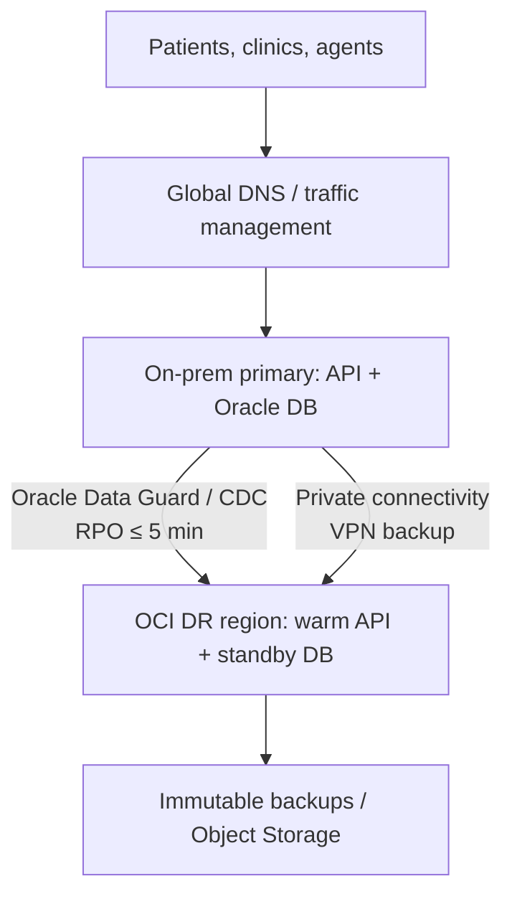

```
Help me complete interview ready note on how we define SLO , SLI , SLA , error budget for with an example of a real prject  Keep the language lucid ( but mention staff level related vocabulary) . On that same help me understand end-2-end task step strategies for Disaster Recovery take example of any real example handson-project.

Use OCI cloud + on prem as primary example and correlate those with AWS - from Healthcare Business domain
```
## Interview-ready notes: SLI, SLO, SLA, and Error Budget

Use this simple relationship:

| Term | Meaning | Owner | Example |
|---|---|---|---|
| **SLI** | A measured indicator of service behavior. | Engineering / SRE | Percentage of successful patient-portal API requests |
| **SLO** | Internal reliability target for an SLI over a time window. | Product + Engineering | 99.95% successful requests in 30 days |
| **SLA** | Customer-facing contractual commitment, often with service credits. | Business / Legal | 99.9% monthly availability |
| **Error budget** | The permitted unreliability implied by the SLO. | Engineering + Product | 0.05% of requests, or 21.6 minutes/month |

### Healthcare project example

Consider a **member and claims portal** used by patients, call-center agents, and partner clinics. It exposes APIs for claims status, eligibility, prior authorization, and FHIR-based clinical-data exchange.

The core claims database and legacy EMR integrations run **on premises**. The digital API and its disaster-recovery environment use **OCI**.

### 1. SLI

The SLI must reflect the user’s actual experience rather than only infrastructure health.

**Availability SLI**

\[
\text{Availability} =
\frac{\text{valid requests} - \text{server-error requests}}{\text{valid requests}}
\]

For example:

- Count: authenticated `GET /claims/{id}` requests.
- Success: HTTP 2xx/3xx, returned within 2 seconds.
- Failure: HTTP 5xx, timeout, or latency above 2 seconds.
- Exclude: malformed client requests (4xx), scheduled maintenance only if explicitly agreed.

A good staff-level statement:

> “I define an SLI at the service boundary using a request-success event. Node uptime is a supporting signal, but it is not the primary reliability metric because a healthy pod can still return incorrect or unusable claims data.”

Other useful SLIs:

- **Latency:** 99% of claim-status requests complete in under 2 seconds.
- **Data freshness:** claims data is no more than 5 minutes behind the on-prem source.
- **Correctness:** reconciliation mismatch rate is below 0.01%.
- **Workflow completion:** percentage of prior-authorization submissions successfully accepted end to end.

### 2. SLO

A possible SLO set:

| User journey | SLO | Window |
|---|---:|---|
| Claim-status and eligibility API | 99.95% successful requests | Rolling 30 days |
| Prior-authorization submission | 99.9% successful workflows | Rolling 30 days |
| Claim-status API latency | 99% under 2 seconds | Rolling 30 days |
| Claims-data freshness | 99.9% within 5 minutes | Rolling 30 days |

For the 99.95% availability SLO:

\[
\text{Error budget} = 1 - 99.95\% = 0.05\%
\]

In a 30-day month:

\[
43,200 \text{ minutes} \times 0.0005 = 21.6 \text{ minutes}
\]

So the service can be unavailable for **21.6 minutes per 30 days**, assuming the SLO is time-based. Request-based measurement is usually better for APIs because it weights outages by real customer impact.

### 3. SLA

The SLA should be slightly less aggressive than the internal SLO, leaving operational headroom.

Example:

> “The claims portal will be available 99.9% per calendar month, excluding agreed maintenance windows. If the target is missed, the customer may receive service credits.”

Why separate them?

- **SLO:** drives engineering decisions and alerts.
- **SLA:** is an external legal/business promise.
- **Headroom:** protects against measurement differences, unexpected incidents, and contractual exposure.

A staff-level phrase:

> “SLOs are product risk decisions, not arbitrary monitoring thresholds. I negotiate them using criticality, patient and provider impact, dependency reliability, recovery objectives, and cost.”

### 4. Error-budget policy

For the 99.95% SLO, the monthly budget is 21.6 minutes.

| Budget consumed | Engineering decision |
|---:|---|
| < 25% | Normal feature delivery |
| 25–50% | Review risky releases; increase observability |
| 50–75% | Freeze high-risk changes; prioritize reliability work |
| > 75% | Reliability focus; leadership/product review |
| 100% consumed | Stop nonessential releases until service stabilizes |

Do not page people merely because the SLO is slightly below target. Page on a **fast burn rate**: for example, an incident consuming the full 30-day budget in one hour.

---

## End-to-end Disaster Recovery strategy

### Scenario

A healthcare claims platform has:

- **On-prem primary:** Oracle Database, EMR/claims integration, Kubernetes application services.
- **OCI DR region:** warm standby application tier and Oracle Database standby.
- **Network:** redundant private links between on-prem and OCI, with VPN backup.
- **Data:** PHI is encrypted in transit and at rest; access is least-privilege, audited, and tested.
- **RTO:** 60 minutes for patient-facing claims/eligibility.
- **RPO:** 5 minutes for claims and authorization transactions.

**RTO** means maximum acceptable recovery time.  
**RPO** means maximum acceptable data loss measured in time.

### Architecture



### DR strategy selection

This is a **warm standby** design.

- On-prem remains the primary production site.
- OCI has a continuously synchronized database standby.
- Application capacity is pre-provisioned at minimum viable size and scales during DR.
- Infrastructure and configuration are reproducible through Terraform, Helm, GitOps, and versioned runbooks.

This is stronger than **backup-and-restore**, but cheaper than fully active-active multi-site operation.

| DR pattern | Typical RTO/RPO | Fit for healthcare claims |
|---|---|---|
| Backup and restore | Hours / hours | Archives or reporting |
| Pilot light | Hours / minutes | Lower-tier services |
| Warm standby | Minutes to ~1 hour / minutes | Claims, eligibility, prior authorization |
| Active-active | Seconds / near-zero | Only for highly critical patient-care workflows |

AWS calls the equivalent approaches backup/restore, pilot light, warm standby, and multi-site active-active. [AWS Well-Architected Reliability guidance](https://docs.aws.amazon.com/wellarchitected/latest/reliability-pillar/rel_planning_for_recovery_disaster_recovery.html)

---

## Hands-on implementation plan

### Phase 1 — Discover and tier workloads

1. Map business capabilities: eligibility, claims status, prior authorization, provider directory, reporting.
2. Identify dependencies: database, MQ, FHIR gateway, LDAP/identity, DNS, certificates, external clearinghouses.
3. Classify each service by criticality and define its RTO/RPO.
4. Identify the **failure domains**: pod, cluster, on-prem data center, connectivity, OCI availability domain, region, identity provider, and third-party partner.

Example tiering:

| Tier | Workload | RTO | RPO | DR approach |
|---|---|---:|---:|---|
| 0 | Patient-critical authorization workflow | 30 min | 1 min | Warm standby / selective active-active |
| 1 | Claims status and eligibility | 60 min | 5 min | OCI warm standby |
| 2 | Provider portal and reporting | 8 hrs | 4 hrs | Backup + restore |
| 3 | Analytics sandbox | 48 hrs | 24 hrs | Restore on demand |

### Phase 2 — Build the OCI landing zone

1. Create a separate OCI DR region and compartment structure.
2. Build VCNs, private subnets, NSGs/security lists, route tables, DNS, Vault/KMS, and logging.
3. Establish dual private connectivity from on-prem to OCI; retain site-to-site VPN as a break-glass path.
4. Use Terraform modules so OCI DR is reproducible and reviewed through pull requests.
5. Put PHI workloads in private networks; do not expose databases to the public internet.
6. Centralize audit logs, database audit trails, and security events.

### Phase 3 — Replicate data

For an Oracle Database workload:

1. Configure Oracle Data Guard from on-prem primary to OCI physical standby.
2. Use synchronous or asynchronous transport based on latency and the required RPO.
3. Monitor redo-apply lag continuously.
4. Take encrypted backups independently of replication; replication is not protection from corruption or ransomware.
5. Store backup copies in a separate security boundary with retention and immutability controls where available.
6. Reconcile counts, checksums, and key business records after drills.

Oracle’s Data Guard documentation covers configuring a standby database for a hybrid DR topology. [Oracle documentation](https://docs.oracle.com/en/solutions/dr-oci-to-oracle-compute-cloud-at-customer/configure-oracle-data-guard-oracle-database1.html)

### Phase 4 — Replicate and recover applications

1. Package applications as containers.
2. Store images in OCI Container Registry.
3. Replicate Helm charts, secrets references, policy definitions, and configuration through GitOps.
4. Deploy minimum warm capacity in OKE or OCI Compute.
5. Keep secrets in OCI Vault; recreate access through IAM policies rather than copying secrets manually.
6. Ensure application configuration can switch database endpoints without code changes.
7. Configure OCI load balancer, WAF, DNS health checks, and certificate renewal.

A key principle:

> “The DR environment must be deployable from source-controlled infrastructure definitions. Manual console configuration creates recovery uncertainty and configuration drift.”

### Phase 5 — Automate the DR runbook

Use OCI Full Stack Disaster Recovery to organize protected resources and execute ordered plans. OCI supports protection groups and separate planned switchover and unplanned failover plans; plan groups can run steps in parallel while groups execute in sequence. [OCI Full Stack DR documentation](https://docs.oracle.com/en/solutions/full-stack-dr-weblogic-platform/configure-full-stack-disaster-recovery.html)

**Planned switchover** — maintenance or DR test:

1. Declare change window and freeze risky deployments.
2. Validate replication lag, backup integrity, OCI capacity, certificates, and DNS health.
3. Quiesce writes or drain in-flight transactions.
4. Gracefully stop on-prem application writes.
5. Switchover Data Guard so OCI becomes primary.
6. Start OCI API services and consumers.
7. Shift DNS/traffic to OCI.
8. Run synthetic patient/agent journeys.
9. Reconcile data and formally declare service restored.

**Unplanned failover** — data-center or major outage:

1. Incident commander confirms the outage and declares DR.
2. Fence the on-prem primary if it may still be reachable. This prevents **split brain** and duplicate claims processing.
3. Confirm last known replication lag and business-approved data-loss exposure.
4. Promote the OCI standby database.
5. Scale OCI application services.
6. Redirect traffic through DNS or global traffic management.
7. Validate identity, API, database, queue, FHIR, and partner-clearinghouse flows.
8. Communicate RPO exposure, service state, and user impact.
9. Begin continuous audit and reconciliation.

### Phase 6 — Validate recovery with business journeys

Technical health checks alone are insufficient. Test:

- Patient retrieves claim status.
- Call-center agent checks eligibility.
- Provider submits prior authorization.
- FHIR data exchange works securely.
- A claim is created once, with no duplicate processing.
- Audit events are captured.
- Reconciliation proves the recovered data meets the RPO.

### Phase 7 — Failback and continuous improvement

1. Stabilize OCI as temporary primary.
2. Repair on-prem infrastructure.
3. Rebuild it as a standby from the new OCI primary.
4. Validate replication and application readiness.
5. Perform a controlled switchover back to on premises if that remains the desired primary.
6. Publish the incident review: timeline, RTO/RPO achievement, gaps, owners, and due dates.
7. Turn findings into backlog items, Terraform/Helm changes, runbook improvements, and new game days.

---

## OCI to AWS correlation

| Capability | OCI + on-prem | AWS equivalent |
|---|---|---|
| Private hybrid connectivity | FastConnect + VPN | Direct Connect + Site-to-Site VPN |
| Kubernetes | OKE | EKS |
| Container registry | OCI Container Registry | Amazon ECR |
| Database DR | Oracle Data Guard to OCI | Oracle Data Guard on EC2 / RDS cross-Region options where applicable |
| Object backup | OCI Object Storage | Amazon S3 |
| Key management | OCI Vault | AWS KMS / Secrets Manager |
| DNS / traffic failover | OCI DNS / Traffic Management | Route 53 health checks and failover routing |
| DR orchestration | OCI Full Stack Disaster Recovery | AWS Elastic Disaster Recovery, Systems Manager Automation, Step Functions |
| Infrastructure as code | Terraform / OCI Resource Manager | Terraform / CloudFormation / CDK |
| Monitoring | OCI Monitoring, Logging, APM | CloudWatch, X-Ray, CloudTrail |

