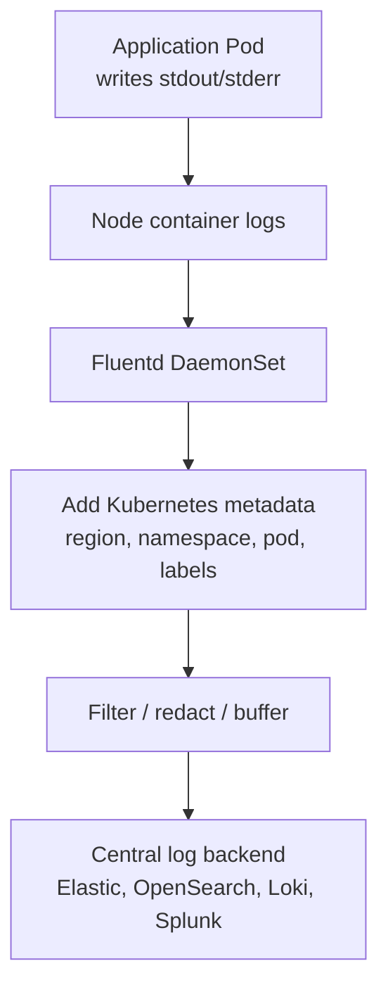
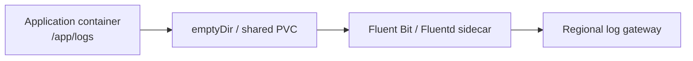

# Fluentd

**Fluentd** is a log collection and forwarding agent. It collects logs, enriches them, filters sensitive data, and sends them to a central log platform.

It is mainly for **logs**, not application metrics or distributed tracing.



## How Fluentd knows which Pod produced a log

Kubernetes creates container log files on each node.

```text
/var/log/containers/
  orchestrator-abc_uipath-prod_orchestrator-<container-id>.log
```

Fluentd runs as a **DaemonSet**, one Pod per Kubernetes node.

```text
Node 1 → Fluentd Pod
Node 2 → Fluentd Pod
Node 3 → Fluentd Pod
```

It tails node-level container log files and parses information from the filename:

```text
Pod name
namespace
container name
container ID
```

Then it calls the Kubernetes API to add labels and workload metadata.

```text
Raw log:
"job dispatch failed"

Enriched log:
region=ap-south-1
cluster=uipath-in-prod-01
namespace=uipath-prod
pod=orchestrator-7d89cc9f76-k8zjl
container=orchestrator
app=orchestrator
version=2026.09.24.3
message="job dispatch failed"
```

## Typical Fluentd pipeline

```text
Input
→ Parse
→ Kubernetes metadata enrichment
→ Filter/redact
→ Buffer locally
→ Forward securely
→ Retry on central-backend failure
```

Example:

```text
Container stdout
→ Fluentd
→ Elasticsearch / OpenSearch / Loki / Splunk
→ Grafana / Kibana dashboard and alerts
```

## Minimal Kubernetes setup

```yaml
apiVersion: apps/v1
kind: DaemonSet
metadata:
  name: fluentd
  namespace: observability
spec:
  selector:
    matchLabels:
      app: fluentd
  template:
    metadata:
      labels:
        app: fluentd
    spec:
      serviceAccountName: fluentd
      containers:
        - name: fluentd
          image: fluent/fluentd:v1.16
          volumeMounts:
            - name: varlog
              mountPath: /var/log
              readOnly: true
            - name: containers
              mountPath: /var/lib/containerd
              readOnly: true
      volumes:
        - name: varlog
          hostPath:
            path: /var/log
        - name: containers
          hostPath:
            path: /var/lib/containerd
```

In production, use the vendor-supported manifest or Helm chart and pin its image version. This simplified example only shows the operating model.

## Fluentd configuration concepts

```conf
# Read Kubernetes container logs
<source>
  @type tail
  path /var/log/containers/*.log
  pos_file /var/log/fluentd-containers.log.pos
  tag kubernetes.*
  <parse>
    @type json
  </parse>
</source>

# Look up Kubernetes Pod metadata
<filter kubernetes.**>
  @type kubernetes_metadata
</filter>

# Send to central logging platform
<match kubernetes.**>
  @type elasticsearch
  host central-opensearch.company.com
  port 443
  scheme https
  index_name k8s-logs
</match>
```

## Fluentd versus OpenTelemetry Collector

| Need | Fluentd | OpenTelemetry Collector |
|---|---|---|
| Container log collection | Strong, mature use case | Supported |
| Log parsing and filtering | Very strong plugin ecosystem | Supported, usually simpler |
| Kubernetes metadata enrichment | Strong | Supported |
| Metrics collection | Not its primary purpose | Core use case |
| Distributed tracing | Not its primary purpose | Core use case |
| OpenTelemetry standard | Can forward to it | Native |
| Typical role | Dedicated log agent | Unified telemetry pipeline |

A common enterprise model:

```text
Fluent Bit on every Kubernetes node
→ Fluentd or OpenTelemetry Collector gateway per region
→ central logging platform
```

Use **Fluent Bit** rather than Fluentd directly on every node when resource efficiency matters. Fluent Bit is lighter and generally better suited for high-volume container-log collection. Use Fluentd where you need heavier parsing, transformation, buffering, or a large existing Fluentd plugin setup.

For your regional UiPath design:

```text
UiPath / Ingress / Robot-related Pod logs
→ regional Fluent Bit DaemonSet
→ regional Fluentd or OTel gateway
→ central log platform
```

Add `region`, `cluster`, `namespace`, `service`, and `version` to every record so the central dashboard can isolate a regional failure quickly.

---

## Different log path

If the log path differs, configure Fluentd to read that specific path. The right solution depends on where the log exists.

## Case 1: Standard Kubernetes container stdout/stderr

Even if the runtime stores logs differently, prefer the Kubernetes symlink path:

```text
/var/log/containers/*.log
```

On many nodes this links to:

```text
/var/log/pods/
/var/log/containers/
```

Container runtime locations may be:

```text
containerd: /var/log/pods/.../*.log
Docker:     /var/lib/docker/containers/<container-id>/<container-id>-json.log
CRI-O:      usually /var/log/pods/.../*.log
```

Check the real node path:

```bash
ls -l /var/log/containers
ls -l /var/log/pods
```

Fluentd configuration:

```conf
<source>
  @type tail
  path /var/log/containers/*.log
  pos_file /var/log/fluentd-containers.pos
  tag kubernetes.*
  read_from_head true

  <parse>
    @type cri
  </parse>
</source>
```

Use `@type cri` for Kubernetes CRI log format. Do not assume every Kubernetes log is JSON.

---

## Case 2: Application writes to a custom path inside its container

Example:

```text
/app/logs/orchestrator.log
```

A node-level Fluentd DaemonSet **cannot automatically see that file**. It can only read node filesystem paths or mounted volumes.

Use one of these options.

### Preferred: log to stdout

```text
Application log
→ stdout/stderr
→ Kubernetes standard container log
→ /var/log/containers/*.log
→ Fluent Bit/Fluentd
```

For Java applications, configure the logging framework console appender. For .NET, Node.js, Python, etc., emit structured logs to stdout.

This is the standard Kubernetes approach.

### Option: shared volume plus sidecar

Use when the application cannot write to stdout.



```yaml
spec:
  volumes:
    - name: app-logs
      emptyDir: {}

  containers:
    - name: app
      image: company/orchestrator:v1
      volumeMounts:
        - name: app-logs
          mountPath: /app/logs

    - name: log-sidecar
      image: cr.fluentbit.io/fluent/fluent-bit:3.1
      volumeMounts:
        - name: app-logs
          mountPath: /app/logs
          readOnly: true
```

The sidecar reads:

```text
/app/logs/*.log
```

and sends to the same regional log gateway.

### Option: hostPath-mounted application logs

Use only for workloads intentionally writing logs on the Node filesystem.

```text
Application:
  /mnt/node-logs/uipath/*.log

Fluentd DaemonSet:
  mounts /mnt/node-logs/uipath
  tails *.log
```

This ties the workload to a node and is usually a poor fit for normal Kubernetes applications.

---

## Case 3: Multiple log paths

Define multiple Fluentd sources.

```conf
# Kubernetes stdout/stderr logs
<source>
  @type tail
  path /var/log/containers/*.log
  pos_file /var/log/fluentd-containers.pos
  tag kubernetes.container
  <parse>
    @type cri
  </parse>
</source>

# Node-level ingress logs
<source>
  @type tail
  path /var/log/nginx/access.log,/var/log/nginx/error.log
  pos_file /var/log/fluentd-ingress.pos
  tag platform.ingress
  <parse>
    @type nginx
  </parse>
</source>

# Custom UiPath shared-volume logs
<source>
  @type tail
  path /uipath-logs/*.log
  pos_file /var/log/fluentd-uipath.pos
  tag uipath.application
  <parse>
    @type json
  </parse>
</source>
```

Use a separate `pos_file` per source. It stores the read offset and prevents Fluentd from resending the entire file after restart.

---

## Case 4: Different format, not just different path

The parser must match the log format.

| Log format | Fluentd parser |
|---|---|
| Kubernetes CRI stdout/stderr | `@type cri` |
| One JSON object per line | `@type json` |
| NGINX access log | `@type nginx` |
| Custom plain text | `@type regexp` |
| Java stack traces | Multiline parser plus regex |
| Windows Event Logs | Windows collector / event-log input |

Example JSON application log:

```json
{"level":"ERROR","event":"job_dispatch_failed","region":"ap-south-1"}
```

```conf
<parse>
  @type json
  time_key timestamp
  time_type string
</parse>
```

## Operational checks

```bash
kubectl -n observability logs ds/fluentd
kubectl -n observability get pods -l app=fluentd
```

Verify:

- Fluentd has a read-only mount for the actual log location.
- its service account can query Pod metadata if Kubernetes enrichment is enabled.
- its parser matches the log format.
- position files are persistent enough for its restart model.
- multiline logs are correctly combined.
- log rotation does not lose or duplicate entries.
- all records include `region`, `cluster`, `namespace`, `pod`, and `container`.

The preferred hierarchy is:

```text
stdout/stderr first
→ shared-volume sidecar if unavoidable
→ hostPath only for node-level/system logs
```


