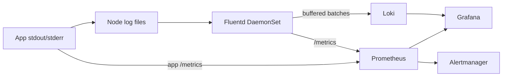

# Who Watches the Log Pipeline?
*Monitoring Your Logging Pipeline Before It Fails*.
*Fluentd, Loki, Prometheus, and Grafana on Kubernetes with containerd*

Your dashboards are quiet and no errors are coming in. That could mean the system is healthy, or it could mean the logging pipeline has been backing up for six hours. A quiet log dashboard is not evidence of a healthy system.

The fix is to treat log delivery as a service with its own health signals:

- **Fluentd** carries log events from nodes to storage.
- **Loki** stores and indexes them.
- **Prometheus** watches the delivery path (queue depth, errors, scrape availability) and stores no logs.
- **Grafana** puts metrics and logs side by side.
- **Alertmanager** pages someone when the delivery path degrades.



This post is a single-cluster working pattern: one Loki replica on persistent filesystem storage, so it deploys without a cloud account. Before treating it as production, move Loki to object storage with multiple replicas.

**Assumptions:** a default StorageClass, `kubectl`, Helm 3, and containerd as the runtime.

## 1. Install the metrics stack

```bash
helm repo add prometheus-community https://prometheus-community.github.io/helm-charts
helm repo add grafana-community https://grafana-community.github.io/helm-charts
helm repo add fluent https://fluent.github.io/helm-charts/
helm repo update

kubectl create namespace monitoring
kubectl create namespace logging
```

`monitoring-values.yaml`:

```yaml
prometheus:
  prometheusSpec:
    retention: 15d
    serviceMonitorSelectorNilUsesHelmValues: false
    podMonitorSelectorNilUsesHelmValues: false
    serviceMonitorNamespaceSelector: {}
    ruleSelectorNilUsesHelmValues: false
    ruleNamespaceSelector: {}

grafana:
  additionalDataSources:
    - name: Loki
      uid: loki
      type: loki
      access: proxy
      url: http://loki-gateway.logging.svc.cluster.local
      isDefault: false
```

```bash
helm upgrade --install monitoring prometheus-community/kube-prometheus-stack \
  --namespace monitoring --values monitoring-values.yaml --wait
```

The `NilUses...: false` settings let Prometheus discover the Fluentd `ServiceMonitor` and alert rules in `logging`. In a shared cluster, scope them with explicit namespace and label selectors instead of accepting everything.

## 2. Install Loki

`loki-values.yaml`:

```yaml
deploymentMode: Monolithic

loki:
  auth_enabled: false
  commonConfig:
    replication_factor: 1
  storage:
    type: filesystem
  schemaConfig:
    configs:
      - from: "2024-04-01"
        store: tsdb
        object_store: filesystem
        schema: v13
        index:
          prefix: loki_index_
          period: 24h

singleBinary:
  replicas: 1
  persistence:
    enabled: true
    size: 50Gi

backend:
  replicas: 0
read:
  replicas: 0
write:
  replicas: 0
```

```bash
helm upgrade --install loki grafana-community/loki \
  --namespace logging --values loki-values.yaml --wait

kubectl -n logging get pods,svc,pvc
```

This is one failure domain. Persistent storage survives a Pod restart, but a node or storage failure means downtime. Loki chart values change between major versions (older releases call this mode `SingleBinary`), so render and inspect before installing:

```bash
helm template loki grafana-community/loki \
  --namespace logging --values loki-values.yaml > loki-rendered.yaml
```

The chart's gateway provides the URL that both Fluentd and Grafana use.

## 3. Deploy Fluentd on every node

The Fluentd chart defaults to an Elasticsearch output. These values replace the source, filters, and output with a containerd-to-Loki pipeline.

`fluentd-values.yaml`:

```yaml
kind: DaemonSet

# Default image variant ships the Kubernetes log-collection plugins.
# For production, build and pin your own image with the Loki plugin.
variant: elasticsearch7
plugins:
  - fluent-plugin-grafana-loki

# containerd: /var/log/containers entries are symlinks into /var/log/pods,
# so mounting /var/log is enough. /var/lib/docker/containers doesn't exist.
mountVarLogDirectory: true
mountDockerContainersDirectory: false

tolerations:
  - operator: Exists
    effect: NoSchedule

resources:
  requests:
    cpu: 100m
    memory: 256Mi
  limits:
    memory: 1Gi

metrics:
  serviceMonitor:
    enabled: true
    additionalLabels:
      release: monitoring

fileConfigs:
  01_sources.conf: |-
    <source>
      @type tail
      @id containers
      path /var/log/containers/*.log
      pos_file /var/log/fluentd-containers.pos
      tag kubernetes.*
      read_from_head true
      emit_unmatched_lines true
      <parse>
        @type regexp
        expression /^(?<time>[^ ]+) (?<stream>stdout|stderr) (?<flag>[^ ]+) (?<log>.*)$/
        time_key time
        time_format %Y-%m-%dT%H:%M:%S.%N%:z
        keep_time_key false
      </parse>
    </source>

    <source>
      @type prometheus
      bind 0.0.0.0
      port 24231
      metrics_path /metrics
    </source>

    <source>
      @type prometheus_output_monitor
      interval 10
    </source>

  02_filters.conf: |-
    # Don't ingest Fluentd's own logs (feedback loop)
    <match kubernetes.var.log.containers.fluentd**>
      @type null
    </match>

    <filter kubernetes.**>
      @type kubernetes_metadata
      skip_labels true
      skip_namespace_metadata true
    </filter>

  04_outputs.conf: |-
    <match kubernetes.**>
      @type loki
      @id out_loki
      url http://loki-gateway.logging.svc.cluster.local
      extra_labels {"cluster":"example","environment":"dev"}
      line_format json

      <label>
        namespace $.kubernetes.namespace_name
        container $.kubernetes.container_name
      </label>

      <buffer>
        @type file
        path /var/log/fluentd-buffer/loki
        flush_mode interval
        flush_interval 5s
        chunk_limit_size 1m
        total_limit_size 5g
        overflow_action block
        retry_forever true
        retry_max_interval 30s
      </buffer>
    </match>
```

Set `cluster` and `environment` to real values, then deploy:

```bash
helm upgrade --install fluentd fluent/fluentd \
  --namespace logging --values fluentd-values.yaml --wait

kubectl -n logging rollout status daemonset/fluentd
kubectl -n logging get servicemonitor
```

Four choices need deliberate review:

- **CRI parsing.** The regex targets the standard containerd format (`<time> <stream> <flag> <message>`). Test it against a real line from your nodes. The `flag` field is `P` for partial lines (long messages split by the runtime) and `F` for full. Production setups should concatenate `P` lines, or a long JSON log arrives as broken fragments. If you have mixed runtimes, keep the chart's default multi-format parser instead.
- **File buffers cost node disk.** At 5 GiB per node, capacity and eviction thresholds are part of the design. `overflow_action block` applies backpressure when the buffer is full, but it cannot guarantee lossless logging if the source files rotate before Fluentd catches up.
- **`read_from_head true`** re-reads existing logs on first deploy. Loki rejects samples older than its configured age limit, so expect some rejected lines at first. The `pos_file` prevents re-reads after that.
- **Pin the image.** The chart's `plugins` setting installs the gem when the Pod starts, which makes restarts depend on package-registry availability. Bake `fluent-plugin-grafana-loki` into a pinned image for production.

## 4. Verify the full path

Generate a recognizable line:

```bash
kubectl -n logging run log-check --image=busybox:1.36 --restart=Never \
  -- sh -c 'echo "observability-check-001"; sleep 300'
```

Forward Grafana:

```bash
kubectl -n monitoring port-forward svc/monitoring-grafana 3000:80
```

In Grafana at `http://localhost:3000`, open **Explore → Loki**:

```logql
{namespace="logging"} |= "observability-check-001"
```

Then switch to Prometheus and check the delivery path:

```promql
up{namespace="logging"}
fluentd_output_status_buffer_queue_length
fluentd_output_status_buffer_total_bytes
fluentd_output_status_num_errors
```

If the test line is missing, walk the path in order: node `/var/log/containers`, then Fluentd Pod logs and buffer, then Loki gateway response, then the Loki query. A running Fluentd Pod proves very little about successful delivery.

## 5. Alert on the pipeline, not just the apps

Create `fluentd-alerts.yaml`:

```yaml
apiVersion: monitoring.coreos.com/v1
kind: PrometheusRule
metadata:
  name: fluentd-pipeline
  namespace: logging
spec:
  groups:
    - name: fluentd
      rules:
        - alert: FluentdNodeCoverageGap
          expr: kube_daemonset_status_number_unavailable{namespace="logging",daemonset="fluentd"} > 0
          for: 5m
          labels: {severity: warning}
          annotations:
            summary: Fluentd is not running on some nodes

        - alert: FluentdTargetDown
          expr: up{namespace="logging", job=~".*fluentd.*"} == 0
          for: 5m
          labels: {severity: warning}
          annotations:
            summary: Prometheus cannot scrape a Fluentd Pod

        - alert: FluentdOutputErrors
          expr: increase(fluentd_output_status_num_errors[5m]) > 0
          for: 5m
          labels: {severity: warning}
          annotations:
            summary: Fluentd is failing to deliver to Loki

        - alert: FluentdBacklogGrowing
          expr: >
            deriv(fluentd_output_status_buffer_queue_length[10m]) > 0
            and fluentd_output_status_buffer_queue_length > 5
          for: 10m
          labels: {severity: warning}
          annotations:
            summary: Fluentd buffer queue keeps growing

        - alert: FluentdBufferNearlyFull
          expr: fluentd_output_status_buffer_available_space_ratio < 20
          for: 5m
          labels: {severity: critical}
          annotations:
            summary: Fluentd buffer under 20% free; backpressure imminent
```

```bash
kubectl apply -f fluentd-alerts.yaml
```

Confirm the exact series and labels from your plugin version before relying on these, since `fluent-plugin-prometheus` metric names and labels have changed across releases.

### Add an end-to-end canary

Agent metrics can all look healthy while logs still fail to arrive, for example through a parser mismatch, a rejected label, or a Loki ingestion limit. A canary tests collection, parsing, transport, storage, and querying together. Run one on every node so each agent is covered:

```yaml
apiVersion: apps/v1
kind: DaemonSet
metadata:
  name: log-canary
  namespace: logging
spec:
  selector:
    matchLabels: {app: log-canary}
  template:
    metadata:
      labels: {app: log-canary}
    spec:
      tolerations:
        - operator: Exists
      containers:
        - name: canary
          image: busybox:1.36
          command: ["sh", "-c", "while true; do echo \"log-canary $(date +%s)\"; sleep 30; done"]
          resources:
            requests: {cpu: 5m, memory: 8Mi}
```

Then alert in Grafana on absence:

```logql
sum(count_over_time({namespace="logging", container="canary"}[5m]))
```

Fire when the result is `0` or no data. This catches total loss. To catch a single node going silent, parse the Pod or node name out of the JSON body and alert per value.

The Loki chart also ships its own canary, but a Fluentd-specific one catches mistakes in your collector config that Loki's canary never sees.

## Design tradeoffs to settle before production

- **Loki vs. OpenSearch.** Loki suits stream- and time-based investigation with few indexed labels. OpenSearch suits broad indexed-field search and heavier analytics, at the cost of more index and cluster operations.
- **Labels vs. log fields.** Keep `cluster`, `environment`, `namespace`, and a stable service name as labels. Keep request IDs and trace IDs in the JSON body or structured metadata. High-cardinality labels create excessive streams and degrade Loki.
- **DaemonSet vs. central aggregator.** Node agents sit closest to the log files. Add a central Fluentd tier only if you need central routing, redaction, or isolation that justifies another hop and failure domain.
- **Buffer sizing.** Size from peak bytes per second × the outage you must survive, plus headroom. Decide what happens when capacity runs out, and review node disk-pressure eviction thresholds and container log rotation together.
- **Security and retention.** Restrict Loki and `/metrics` to intended clients, encrypt and authenticate cross-cluster traffic, and remove sensitive fields before shipping. Loki retention requires Compactor configuration, so provisioning storage alone does not enforce it.
- **Rollout.** Pin chart and image versions, render manifests in CI, and roll Fluentd to a small node group first. Test log continuity through a Loki outage, a Fluentd restart, and a node drain.

## The takeaway

```text
Fluentd moves logs. Loki stores them. Prometheus watches the movement.
A quiet log dashboard is never proof of health, so alert on delivery, not just on content.
```

When logging breaks, you lose the data you would use to debug it, so monitor the collector, its queue, and whether a test log actually reaches storage.

