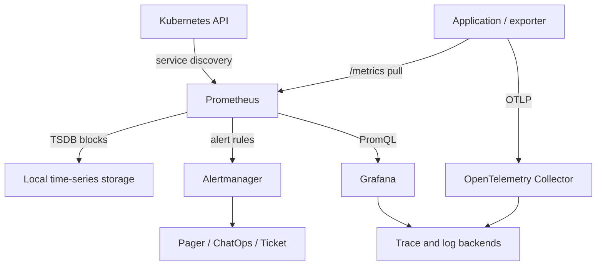

```
Topic: Monitoring , Observability , Logging , Telemetry , Prometheus , Grafana

Cover:

1. Core concept — plain-English explanation, then the "textbook" definition an interviewer expects to hear.
2. Why it exists — the problem it solves, what came before it.
3. How it works internally — architecture/mechanics, not just usage.
4. Common interview questions — 5-8 questions ranging from basic to senior-level, with model answers.
5. Trick/gotcha questions — things that sound simple but trip people up (edge cases, misconceptions).
6. Real-world scenario — a "walk me through how you'd handle X" question with a structured answer.
7. Comparison — how it stacks up against alternatives (if relevant), with a quick decision table.
8. Coding/config example — a working, minimal example (YAML/CLI/code) I could type out on a whiteboard or explain line-by-line.
9. Common mistakes — what junior/mid engineers get wrong, so I can show senior-level judgment.
10. One "gotcha" follow-up — the kind of curveball question an interviewer throws after my answer, to test depth.

```

## 1. Core concept

**Plain English:**  
Monitoring tells you when a known bad condition happens. Observability gives you enough signals to explain *why* an unknown problem happened.

- **Metrics:** numeric trends over time — CPU, latency, error rate, queue depth.
- **Logs:** discrete event records — request failed, certificate rejected, pod restarted.
- **Traces:** one request’s path across services — where time was spent or where it failed.
- **Telemetry:** the collective data emitted by systems: metrics, logs, traces, and sometimes profiles.

**Interview definition:**  
> Observability is the ability to infer a system’s internal state from its externally emitted telemetry. Monitoring is the operational practice of collecting, visualizing, and alerting on predefined health and performance signals.

Prometheus is primarily a metrics collection, storage, query, and alert-rule engine. Grafana is primarily a visualization and alerting interface that can query Prometheus and many other data sources.

---

## 2. Why it exists

Before modern observability, teams relied on:

- host-level checks: CPU, disk, process up/down;
- manually SSHing to servers;
- flat log files and `grep`;
- infrastructure-centric dashboards.

That worked for monoliths and static VMs. It breaks down in Kubernetes because workloads are ephemeral, requests cross many services, and failure may be caused by application code, DNS, network policy, certificates, a dependency, or resource saturation.

The goal is to reduce:

- **MTTD** — mean time to detect;
- **MTTR** — mean time to recover;
- alert noise;
- blind scaling decisions;
- time spent guessing during incidents.

---

## 3. How it works internally



### Prometheus mechanics

1. **Service discovery**  
   Prometheus discovers Kubernetes targets via the API server: nodes, pods, Services, endpoints, ingress, etc.

2. **Scrape model**  
   Prometheus pulls an HTTP endpoint, commonly `/metrics`, on a schedule such as every 15 or 30 seconds.

3. **Metric format**  
   A time series is:

   ```text
   metric_name{label="value"} timestamp value
   ```

   Example:

   ```text
   http_requests_total{service="orders",status_code="500"} 41
   ```

4. **Storage**  
   Samples are stored in Prometheus’s local TSDB: write-ahead log, head block for recent samples, then immutable compressed blocks. For high availability and long retention, use remote storage—commonly Thanos, Cortex, Mimir, or a managed Prometheus service.

5. **PromQL**  
   PromQL evaluates instant values, ranges, rates, aggregations, joins, and histogram quantiles.

6. **Alert evaluation**  
   Prometheus periodically evaluates recording and alerting rules. Alerts are sent to Alertmanager, which groups, deduplicates, routes, silences, and inhibits notifications.

### Cardinality is the critical internal design concern

Every unique metric name + full label set is a new time series.

Good labels:

```text
service, namespace, environment, status_code, region
```

Dangerous labels:

```text
patient_id, request_id, order_id, user_id, raw_url, timestamp
```

High cardinality increases memory use, query cost, storage cost, and can cause Prometheus instability.

---

## 4. Common interview questions with model answers

### Q1. What is the difference between monitoring and observability?

> Monitoring answers known questions through predefined dashboards and alerts—for example, “Is error rate above 2%?” Observability lets us investigate unknown failure modes using sufficiently rich metrics, logs, traces, and correlation metadata. Monitoring is a subset of an observability practice.

### Q2. Why does Prometheus use pull instead of push?

> Pull gives Prometheus control over scrape frequency, target health, authentication, and discovery. It makes it easy to see whether a target is down because `up` becomes zero. Push is useful for short-lived batch jobs, usually through Pushgateway, but it should not become a general replacement for application scraping because lifecycle and stale-series management become difficult.

### Q3. Counter versus gauge versus histogram?

> A counter only increases until reset, such as `http_requests_total`. A gauge moves up and down, such as queue depth or memory usage. A histogram records observations into buckets plus count and sum, enabling latency percentiles and SLO calculations. I use `rate()` or `increase()` with counters, not raw counter values.

### Q4. How would you calculate API error rate in PromQL?

```promql
sum(rate(http_requests_total{status_code=~"5.."}[5m]))
/
sum(rate(http_requests_total[5m]))
```

> I would scope it by service and environment, ensure the denominator is nonzero where needed, and use recording rules if it is a heavily reused query.

### Q5. What is the difference between `rate()` and `irate()`?

> `rate()` calculates the average per-second increase over a range and is appropriate for dashboards and alerts. `irate()` uses only the last two samples, so it reacts quickly but is noisy; I use it for short-term visualization, not most alerts.

### Q6. How do you monitor Kubernetes effectively?

> I use multiple signal sources: application metrics, kube-state-metrics for desired versus actual state, kubelet/cAdvisor for container resource usage, node metrics for infrastructure, and synthetic probes for externally visible behavior. I correlate workload health with scheduling, readiness, restarts, CPU throttling, memory pressure, and dependency health.

### Q7. How do you design alerts that engineers do not ignore?

> I alert on sustained user impact, not every anomaly. Each alert needs a severity, owner, meaningful threshold, duration, dashboard, and runbook. I use symptom-based alerts for paging, cause-based alerts for diagnosis, grouping and inhibition in Alertmanager, and SLO burn-rate alerts for customer-impacting services.

### Q8. What are recording rules and why use them?

> Recording rules precompute expensive or frequently reused PromQL expressions into new time series. They reduce dashboard latency, standardize calculations such as error rate, and simplify alert rules. I avoid creating unnecessary derived metrics because they also consume storage and cardinality.

---

## 5. Trick/gotcha questions

| Gotcha | Correct answer |
|---|---|
| “Can Prometheus calculate exact P99 latency?” | Not from coarse histograms. It estimates quantiles from buckets. Bucket design determines accuracy. |
| “Can I average pod P95 latencies?” | No. Aggregate histogram buckets first, then calculate the quantile. |
| “Does a healthy Kubernetes pod mean the application is healthy?” | No. A process can be running while dependencies, DNS, TLS, queues, or business operations fail. |
| “Does HPA solve high latency?” | Only if lack of replica capacity is the bottleneck. Scaling cannot fix a downstream outage, lock contention, DNS issue, or bad certificate. |
| “Can I label metrics with request IDs for debugging?” | No. Put request IDs in logs and traces, not metrics. |
| “Does `up == 1` prove a service is healthy?” | It only proves Prometheus successfully scraped the metrics endpoint. |
| “Should every exception create an alert?” | No. Use error-rate, user-impact, or SLO-based thresholds; errors may be handled, retried, or expected. |

---

## 6. Real-world scenario

### Interview question

> “A Kubernetes-hosted clinical printing/integration gateway becomes intermittently slow and reports connection failures. Walk me through your response.”

### Structured senior-level answer

**1. Establish impact**

- What clinical workflow is affected?
- Is this global, one region, one namespace, one endpoint group, or one release?
- What is the error rate, latency, retry rate, and backlog growth?
- Is there a safe operational workaround?

**2. Check golden signals**

- Traffic: request/job volume.
- Errors: 4xx/5xx, connection errors, failed jobs by reason.
- Latency: P50/P95/P99.
- Saturation: CPU throttling, memory pressure, connection pool, queue depth.

**3. Correlate across telemetry**

- Grafana: failure rate versus DNS latency, TCP probe results, pod restarts, deployments, and HPA events.
- Logs: structured error category, destination hostname, TLS verification error, timeout stage.
- Traces: identify whether time is spent in application logic, DNS lookup, TLS handshake, or downstream processing.
- Kubernetes: events, readiness, endpoints, NetworkPolicies, CoreDNS status, affected nodes.

**4. Validate the hypothesis**

From an affected pod or controlled debug container:

```bash
nslookup printer-gateway.example.internal
curl -vk https://printer-gateway.example.internal/health
openssl s_client -connect printer-gateway.example.internal:443 \
  -servername printer-gateway.example.internal
kubectl get endpoints -n clinical-platform printer-gateway
kubectl get networkpolicy -n clinical-platform
```

**5. Fix the root cause**

For example: stale DNS/service-discovery path plus a certificate SAN mismatch after endpoint migration.

- Correct DNS and remove stale endpoint records.
- Ensure certificate SAN matches the hostname used by clients.
- Validate egress/NetworkPolicy/firewall path.
- Use bounded retries with exponential backoff and connection timeouts.
- Add dependency-aware readiness checks where appropriate.

**6. Prevent recurrence**

- Alert on job failure rate, DNS failures, TLS failures, and synthetic TCP/TLS probe failures.
- Add certificate-expiry monitoring.
- Document a runbook and ownership/escalation path.
- Validate under representative load and observe through a defined CAPA monitoring period.

---

## 7. Comparison

| Tool / approach | Best for | Strength | Limitation |
|---|---|---|---|
| Prometheus | Kubernetes and cloud-native metrics | Pull model, PromQL, strong ecosystem | Local retention/scaling needs planning |
| Grafana | Visualization across many backends | Flexible dashboards and correlation | Not a primary metrics store |
| OpenTelemetry | Standardized telemetry instrumentation | Vendor-neutral metrics, logs, traces | Collector pipelines need careful design |
| ELK / OpenSearch | Log search and investigation | Rich unstructured search | Higher storage cost; not ideal for metric alert math |
| Loki | Cost-efficient Kubernetes logs | Label-based, Grafana-native | Not a full-text-search replacement for every use case |
| Jaeger / Tempo | Distributed tracing | Request-path analysis | Requires good instrumentation and sampling design |
| Datadog / New Relic / Dynatrace | Managed observability | Faster operational setup | Cost and vendor lock-in considerations |

**Typical decision:**  
Use Prometheus + Grafana for Kubernetes metrics, OpenTelemetry for instrumentation, Loki/OpenSearch for logs, and Tempo/Jaeger or a managed tracing backend for traces. Standardize correlation attributes across all signals.

---

## 8. Minimal whiteboard configuration

### Application metrics

```python
from prometheus_client import Counter, start_http_server

requests = Counter(
    "http_requests_total",
    "HTTP requests",
    ["service", "status_code"]
)

start_http_server(8080)  # exposes /metrics
requests.labels("orders", "200").inc()
```

### Kubernetes ServiceMonitor

```yaml
apiVersion: monitoring.coreos.com/v1
kind: ServiceMonitor
metadata:
  name: orders
  namespace: observability
spec:
  namespaceSelector:
    matchNames: ["apps"]
  selector:
    matchLabels:
      app: orders
  endpoints:
    - port: metrics
      path: /metrics
      interval: 30s
```

### Alert rule

```yaml
apiVersion: monitoring.coreos.com/v1
kind: PrometheusRule
metadata:
  name: orders-alerts
  namespace: observability
spec:
  groups:
    - name: orders
      rules:
        - alert: OrdersHigh5xxRate
          expr: |
            sum(rate(http_requests_total{
              service="orders",status_code=~"5.."
            }[5m]))
            /
            sum(rate(http_requests_total{
              service="orders"
            }[5m])) > 0.02
          for: 10m
          labels:
            severity: critical
          annotations:
            summary: "Orders 5xx rate exceeds 2%"
            runbook: "https://runbooks.example/orders"
```

### Grafana panel query

```promql
sum(rate(http_requests_total{
  service="orders",status_code=~"5.."
}[5m]))
/
sum(rate(http_requests_total{
  service="orders"
}[5m]))
```

Explain it line-by-line:

- `rate(...[5m])`: per-second request rate over five minutes.
- `sum(...)`: aggregate across pods.
- numerator: server errors only.
- denominator: all requests.
- `for: 10m`: prevents a transient spike from paging.

---

## 9. Common mistakes

- Alerting on infrastructure metrics before user-impact signals.
- Treating CPU usage as the only scaling signal.
- Using raw counters instead of `rate()` or `increase()`.
- Averaging percentile values instead of aggregating histogram buckets.
- Adding high-cardinality labels.
- Storing sensitive identifiers in telemetry labels or logs.
- Treating `up == 1` as full application health.
- Using readiness probes only to confirm process startup, not traffic safety.
- Alerting without a runbook, owner, dashboard, or actionable threshold.
- Ignoring alert fatigue, inhibition, silences, and maintenance windows.
- Retaining every raw metric forever instead of defining retention/downsampling strategy.
- Not correlating deployment, certificate rotation, DNS/network changes, and incident timestamps.

---

## 10. Curveball follow-up

**Interviewer:**  
> “Your Grafana dashboard shows P95 latency rising, CPU is only 35%, and HPA is not scaling. What do you do?”

**Strong answer:**  
> I would not scale blindly. Low CPU with rising latency often points to a non-CPU bottleneck: downstream dependency latency, DNS, TLS handshakes, connection-pool exhaustion, thread/event-loop saturation, lock contention, network loss, or queue buildup. I would inspect traces to identify the slow span, dependency-specific latency/error metrics, connection-pool and queue metrics, DNS/TLS probe results, and pod-level throttling or restarts. If queue depth per ready replica is the true bottleneck, I would consider a custom-metric HPA; if the downstream service is slow, scaling may worsen the incident by increasing concurrent load.