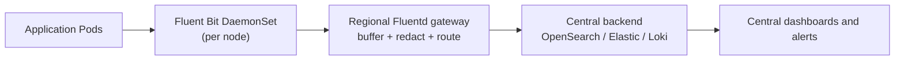

## Multi-Region Kubernetes Logging with Fluent Bit and Fluentd
```
Log Shipping Is Easy Until the Backend Goes Down
```

# Shipping Kubernetes Logs from Regional Clusters to a Central Backend with Fluent Bit and Fluentd

You run Kubernetes clusters in more than one region. Engineers want one place to search logs, but the logs can't just stream from every node to a central backend. A network blip would drop data, a backend outage would back up node disks, and secrets or PII would cross regional boundaries.

The pattern that holds up is a **two-tier pipeline**, with buffering and redaction in the middle:



- **Node agent (Fluent Bit):** tails container logs, adds Kubernetes metadata, and forwards. It is lightweight and does no heavy processing.
- **Regional gateway (Fluentd):** buffers to disk, redacts, routes, and retries, and is the last hop before logs leave the region.
- **Central backend:** stores and indexes logs for search, dashboards, and alerts.

This post covers the config for each tier, what to do when the backend is down, and the controls that make it production-safe.

## 1. Node agent: Fluent Bit DaemonSet

The agent tails `/var/log/containers`, enriches records with Pod metadata, stamps region and cluster, and forwards to the gateway over TLS.

```ini
[SERVICE]
    Flush                     5
    Log_Level                 info
    storage.path              /var/fluent-bit/state/
    storage.sync              normal
    storage.backlog.mem_limit 50M

[INPUT]
    Name              tail
    Path              /var/log/containers/*.log
    Exclude_Path      /var/log/containers/*_observability_*.log
    multiline.parser  docker, cri
    Tag               kube.*
    Mem_Buf_Limit     50MB
    Skip_Long_Lines   On
    DB                /var/fluent-bit/state/flb_kube.db
    storage.type      filesystem

[FILTER]
    Name                kubernetes
    Match               kube.*
    Merge_Log           On
    Keep_Log            Off
    K8S-Logging.Exclude On
    Labels              On
    Annotations         Off

[FILTER]
    Name    record_modifier
    Match   kube.*
    Record  region ap-south-1
    Record  cluster in-prod-01
    Record  environment prod

[OUTPUT]
    Name                     forward
    Match                    kube.*
    Host                     fluentd-gateway.observability.svc.cluster.local
    Port                     24224
    Require_ack_response     On
    Retry_Limit              False
    tls                      On
    tls.verify               On
    tls.ca_file              /fluent-bit/tls/ca.crt
    tls.crt_file             /fluent-bit/tls/tls.crt
    tls.key_file             /fluent-bit/tls/tls.key
```

Choices worth explaining:

- **`storage.type filesystem` plus the `DB` file.** Chunks spill to disk when the gateway is slow, and the tail position survives agent restarts, so a restart neither re-sends nor loses logs. Mount `/var/fluent-bit/state` from a `hostPath`.
- **`Exclude_Path` for the observability namespace.** Container log filenames include the namespace, so this stops the logging stack from ingesting its own output in a feedback loop.
- **`Require_ack_response On`.** The agent treats a chunk as delivered only after the gateway acknowledges it, which gives you at-least-once delivery. Expect occasional duplicates after retries.
- **`Keep_Log Off` with `Merge_Log On`.** JSON logs are parsed into fields and the raw string is dropped. Leave `Keep_Log` on if your apps emit plain text and you want to keep the original line.
- **Region labels via `record_modifier`.** Every record carries `region`, `cluster`, and `environment` before it leaves the node.

The DaemonSet also needs read-only `hostPath` mounts for `/var/log` (container logs are symlinks into `/var/log/pods`), and a ServiceAccount allowed to `get/list/watch` Pods and Namespaces for the `kubernetes` filter.

## 2. Regional gateway: Fluentd

The gateway receives from the agents over TLS, redacts sensitive values, and sends to the central backend. Run it as a **StatefulSet with a PVC** for the buffer. A Deployment's Pod can be rescheduled onto a node without its disk, and the buffered logs go with it.

Input:

```conf
<source>
  @type forward
  bind 0.0.0.0
  port 24224

  <transport tls>
    cert_path /fluentd/tls/tls.crt
    private_key_path /fluentd/tls/tls.key
    ca_path /fluentd/tls/ca.crt
    client_cert_auth true
  </transport>
</source>
```

`client_cert_auth true` makes this mTLS: only agents presenting a certificate signed by your CA can send logs.

Redaction, before anything is exported:

```conf
<filter kube.**>
  @type record_transformer
  enable_ruby true
  <record>
    log ${record["log"].to_s.gsub(/(password|passwd|secret|token|api[_-]?key)(["'=:\s]+)[^\s"',}]+/i, '\1\2[REDACTED]')}
  </record>
</filter>
```

This example masks common credential patterns in the `log` field. Adapt it to your logs: if your apps emit JSON, the message may live in `message` or `msg` after `Merge_Log`, and you may need extra patterns for emails, card numbers, or tokens. Test the regex against real samples, because redaction that silently misses a field is worse than none. For field-level rules, drop or hash specific keys with `record_modifier` or `record_transformer` instead of regex.

## 3. Central backend options

### Option A: OpenSearch or Elasticsearch

Use `fluent-plugin-opensearch` for OpenSearch, or `fluent-plugin-elasticsearch` for Elastic. The config below is for OpenSearch.

```conf
<match kube.**>
  @type opensearch
  host central-opensearch.example.com
  port 443
  scheme https
  user "#{ENV['OPENSEARCH_USERNAME']}"
  password "#{ENV['OPENSEARCH_PASSWORD']}"

  logstash_format true
  logstash_prefix prod-k8s-logs
  include_tag_key true
  tag_key fluentd_tag

  <buffer>
    @type file
    path /buffers/opensearch
    flush_interval 10s
    flush_thread_count 2
    chunk_limit_size 8m
    total_limit_size 20g
    retry_type exponential_backoff
    retry_max_interval 60s
    retry_forever true
    overflow_action block
  </buffer>
</match>
```

This produces daily indices such as `prod-k8s-logs-2026.10.20`. Typical queries:

```text
kubernetes.namespace_name: "prod"
kubernetes.labels.app: "orchestrator"
region: "ap-south-1"
level: "ERROR"
```

### Option B: Loki

```conf
<match kube.**>
  @type loki
  url "https://loki.example.com"
  username "#{ENV['LOKI_USERNAME']}"
  password "#{ENV['LOKI_PASSWORD']}"
  extra_labels {"cluster":"in-prod-01","region":"ap-south-1","environment":"prod"}
  line_format json

  <label>
    namespace $.kubernetes.namespace_name
    service $.kubernetes.labels.app
  </label>

  <buffer>
    @type file
    path /buffers/loki
    flush_interval 10s
    chunk_limit_size 8m
    total_limit_size 20g
    retry_type exponential_backoff
    retry_forever true
    overflow_action block
  </buffer>
</match>
```

Loki indexes labels, not log content, so label cardinality drives cost and performance. Keep labels bounded:

```text
Good labels: region, cluster, namespace, service, environment
Bad labels:  pod_name, job_id, request_id, customer_id, trace_id
```

High-cardinality values belong in the log body, where you can filter on them at query time.

## 4. What happens when the central backend is down

```text
Central backend unavailable
→ gateway writes to its disk buffer
→ retries with exponential backoff
→ delivers when the backend recovers
```

The buffer settings decide what happens next when the outage is long. Two details matter:

- **`retry_forever true` does not mean unlimited storage.** The buffer is capped by `total_limit_size`. When it fills, `overflow_action` decides the behavior. The default, `throw_exception`, raises errors to the sender. `block` applies backpressure instead: the gateway stops acknowledging, and the Fluent Bit agents buffer on their own disks and retry. Prefer `block` so the failure is pushed back toward the sources rather than silently dropping logs.
- **Every buffer in the chain is finite.** Gateway disk, agent disk, and node disk will each eventually fill. Size them for the outage you must survive, and alert well before they are full.

If buffers approach capacity:

```text
Alert the platform team
→ investigate central ingestion failure
→ protect node disks (bounded agent buffers, log rotation)
→ if policy allows, shed low-value logs before critical ones
```

Do not use unbounded disk buffering. A long central outage can fill node disks and take down workloads that have nothing to do with logging.

## 5. Regional endpoint pattern

Each region runs its own gateway, so redaction and buffering happen before logs cross a network or data boundary:

```text
India node agents → fluentd-gateway.in.example.internal → central backend
EU node agents    → fluentd-gateway.eu.example.internal → central backend
```

Every record carries:

```text
region=ap-south-1
cluster=in-prod-01
namespace=prod
service=orchestrator
environment=prod
```

That gives one central search interface while preserving exactly which region, cluster, and workload produced each line. If data residency requires it, the regional gateway can route EU logs to an EU-hosted backend instead of the central one.

## 6. Production controls checklist

| Control | Why |
|---|---|
| TLS, preferably mTLS | Protect logs crossing networks and regions |
| Credentials from Kubernetes Secrets | Keep passwords out of ConfigMaps and images |
| File buffers on persistent disk | Survive network and backend outages, and Pod restarts |
| Bounded buffers with `overflow_action block` | Backpressure instead of disk exhaustion or silent loss |
| Exponential backoff retries | Avoid hammering a recovering backend |
| Redaction in the regional gateway | Keep secrets and PII from leaving the region |
| Regional routing | Lower latency and respect data boundaries |
| Pipeline monitoring | Alert on buffer size, retry counts, and delivery lag |
| Index lifecycle or retention policy | Control central storage cost |
| RBAC and tenant access control | Limit who can read which logs |

## The takeaway

```text
Agents collect and enrich. Gateways buffer, redact, and route. The backend stores.
Every buffer is bounded, and every hop is encrypted and acknowledged.
```

The hard part of log shipping is not the happy path. It's deciding in advance what happens when the backend is down, the buffer fills, or a secret appears in a log line.

